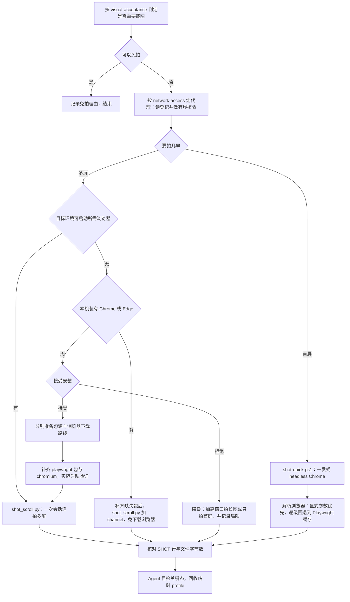

# 无 Playwright 设备的截图工作流

假设条件：一台 Win10 设备，尚未安装 **Playwright**（自动化浏览器库，`shot_scroll.py` 依赖它起浏览器会话）。本文件只讲"用什么拍、按什么顺序拍"，拍不拍、拍什么按 [视觉验收](../../ai-verified-delivery/references/visual-acceptance.md) 判定，代理按 [代理登记](../../network-access/references/proxy-registry.md) 流程准备。



上图分支收敛到同一收尾：脚本打印的 `SHOT` 行与文件字节只证明"拍到了"，**是否符合预期由 Agent 看图判定**，临时浏览器 profile 由脚本自行删除（`shot-quick.ps1` 建后即删，`shot_scroll.py` 用后即关）。

## 两个脚本的分工

| 脚本 | 覆盖 | 最低条件 | 说明 |
|---|---|---|---|
| `scripts/shot-quick.ps1` | 仅首屏视口 (viewport) | `pwsh 7` 加任一 Chrome | 不需要 Playwright；按显式参数、环境变量、`PATH`、固定安装路径、`Playwright` 缓存逐级找浏览器 |
| `scripts/shot_scroll.py` | 首屏加滚动多屏 | 上述加 `playwright` 包（浏览器可免下载，见下） | 一次会话连拍，不为每屏各起一次浏览器 |

Win10 默认自带的是 `powershell 5.1`，而 `shot-quick.ps1` 首行要求 7，必须先装 `pwsh 7`；Python 一律用 `python -X utf8` 启动，避免中文输出乱码。

## 直用本机 Chrome 或 Edge（免下载浏览器）

先确认本机实际安装了 Edge 或 Chrome；可用时免去下载 `chromium` 的一步（仍需目标 Python 环境中的 `playwright` 包）。`--channel` 与 `--executable-path` 互斥：

```powershell
python -X utf8 <skill-dir>/scripts/shot_scroll.py --url 'https://example.com/page' --screens 2 --channel msedge
python -X utf8 <skill-dir>/scripts/shot_scroll.py --url 'https://example.com/page' --screens 2 --channel chrome
```

`--channel msedge` 用本机 Edge，`--channel chrome` 用本机 Chrome；浏览器装在非常规位置时改用 `--executable-path` 指向可执行文件。代理参数与连拍逻辑不变，当前机器仍须实际启动验证。

## 国内安装准备

包源按 [依赖下载](../../network-access/references/dependency-downloads.md) 使用目标解释器和已有安装器，浏览器按 [浏览器安装与国内网络](../../network-access/references/browser-installation.md) 处理。国内浏览器优先已登记代理访问官方 CDN；无代理或代理失败再核验制品镜像，不默认同时填写代理与镜像。

只缺包时沿用 pip/uv 补齐；已有系统浏览器并使用 `--channel` 时可省略浏览器下载。确需 Chromium 时，用同一 Python 环境的 `python -X utf8 -m playwright install chromium`；`--dry-run` 只显示下载计划，不证明镜像可用。配置和启动验证采用共用参考，不在此维护第二份命令模板。

## 执行顺序

1. 按 [视觉验收](../../ai-verified-delivery/references/visual-acceptance.md) 决定拍不拍、拍几屏；纯文案且不影响几何与状态的可记 `N/A` 并写理由。
2. 按 [代理登记](../../network-access/references/proxy-registry.md) 读本机登记并做有界核验，把真实代理值当本次调用参数传入，不写进文档与脚本。
3. 只要首屏时直接用 `shot-quick.ps1`；要第二屏及以下时，先复用目标环境已有 Playwright 和浏览器，再看本机 Chrome/Edge（有则加 `--channel` 免下载浏览器）。
4. 需要补齐工具且安装已授权时，按“国内安装准备”补齐缺失包与浏览器；使用 `--channel` 时只补缺失包，不重复询问已有安装授权。

5. 截图命令（`<skill-dir>` 指本 skill 目录，代理值为占位）：

```powershell
& <skill-dir>/scripts/shot-quick.ps1 -Url 'https://example.com/page' -Proxy 'http://127.0.0.1:<port>'
python -X utf8 <skill-dir>/scripts/shot_scroll.py --url 'https://example.com/page' --screens 2 --discover-proxy
```

6. 核对每屏 `SHOT` 行与文件字节数，Agent 看图确认关键态；失败轮按 [测试资源预算与回收](../../web-app-testing/references/environment-and-maintenance.md) 收尾，不叠加未回收的重试。

## 拒绝安装时的降级

`shot-quick.ps1` 的 `-Height` 可加高（如 `2700`）一次拍长图。高度变化一般不触发宽度媒体查询，但吸顶与固定元素、懒加载行为与真实滚动不同，只能作概览，不能当多屏证据；采用降级时必须在结论中记录局限。
