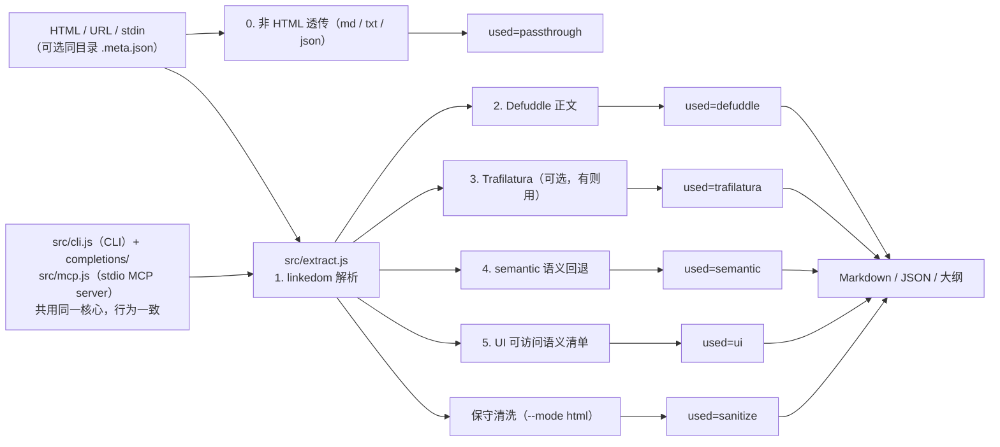

# htmlmini v2

把 HTML 网页（含大量 CSS/JS 样板）压成"核心骨架"，以 Markdown 输出，专为 **LLM 总结省 token** 设计。实测本地设计稿：原始 24KB~99KB → 提取后 300B~1.3KB，**节省约 75%~99.5%**。版本号按日期时间打（`htmlmini --version`，如 `2026.10.19.1750`），用 `pnpm stamp` 更新。

- 引擎链（`auto` 默认）：**非 HTML 透传** → **Defuddle** 正文提取 → **Trafilatura**（可选，见下）→ **semantic** 纯 JS 语义回退 → **UI 组件清单**（面板/仪表盘/设计稿；面板/表单页 UI 信号多且 Trafilatura 抽出的文字不长时，Trafilatura 让位给 UI 清单，避免拿去导航/表头碎片）。`text/plain` 直接返回的 markdown（如某些 gitee 链接）、纯文本、JSON 不硬抽，原样返回（`used=passthrough`）。
- 双形态交付：**CLI**（任意 harness/终端可用）+ **MCP server**（opencode / Claude / Cursor 等当工具调用），共用同一核心，行为一致。
- 需要"结构"而不是"摘要"时用 `--mode html`：保守清洗后的 HTML（去脚本/样式/表观属性，保留完整 DOM 与文本顺序），默认按 `compact` 排版压掉源码缩进与空行，比 markdown 费 token，但看表格、嵌套层级与表单初始态时不必回读原始 HTML。`--pretty` 重排为可读缩进，`--prune-empty` 额外剪掉清洗后变空的容器。
- 两类"正文不在静态 DOM"的页面各有一个显式入口：客户端水合后才出现正文的用 `--render=always` 强制渲染；`ui` 清单默认不收超过 150 字符的长段落，用 `--text-max 0` 取消上限。两处都会在日志/输出里说明实际走了哪条，不静默降级。
- CSS 生成内容会并入文本：`::before` / `::after` 的短标点 `content`（如把小数点做成 `content:"."` 的价格 `$`+`1`+`00`）不再被漏成 `$100`，插入条数记在 `--json` 的 `stats.cssGenerated`。只并 1~3 个安全标点，图标字体（`\e900`）、`url()`、`attr()`、`counter()` 一律跳过；外链 CSS 只在浏览器渲染通路和带 `.meta.json` 的落盘文件上抓取。
- 静态抓取成功但正文极短（< 200 字符且 HTML ≥ 5 KB）时默认报错，提示改用 `--render=always`，避免把应用壳 / 离线页当成正文；确认页面本来就这么短时加 `--allow-empty`。`title` / `skeleton` 不受此检查影响。
- 页面数据由后端接口下发（SPA、白标商城、后台面板）时，先提取可见字段，再按[案例 11](references/usage-cases.md#11-后端接口--xhr-数据源)查页面自己的 XHR/fetch 接口核对；渲染文本只作展示校验，接口也不是公开契约。

## 核心用例

按"最先要解决的事"排，不按功能清单排；完整场景与坑见 [references/usage-cases.md](references/usage-cases.md)。

| 场景 | 命令 | 说明 |
|---|---|---|
| 文章、博客、文档（最常用） | `htmlmini "<URL>" -o page.md` | 默认 Markdown，Defuddle 正文 |
| 静态 200 但正文要等水合 | `htmlmini "<URL>" --render=always` | 强制执行 JS；拿到 `engine=static` 会自动换浏览器层重跑 |
| 异步清单 / 下拉框 / 懒加载（特色） | `htmlmini "<URL>" --render=always --wait-selector '<目标块>' --expect-text '<只在目标块里出现的文本>' --save-html page.html` | 等目标节点出现并断言真的抓到，缺了直接失败；控件值只在 HTML 里 |
| 清单藏在表单控件里（特色） | `htmlmini page.html -m --keep-options` | 正文模式默认丢控件值；追加"表单选项"：下拉框/optgroup/datalist/单选多选 |
| 403 / 挑战 / 自动化被拦 | `htmlmini "<URL>" --render` 或 `--render=always --render-engine chrome-late` | 静态优先，挑战站点走晚接入引擎 |
| 面板、仪表盘、设计稿 | `htmlmini page.html -u` | 按可访问语义出组件清单（标签/按钮/字段/表格） |
| 要结构不要摘要 | `htmlmini page.html --mode html --attrs semantic` | 保留 DOM 顺序与表格/表单状态（含 value/selected/checked） |
| 抓一次、多视图复用 | `htmlmini "<URL>" --render=always --save-html page.html` | 之后 `htmlmini page.html -m` / `-u` 不再联网 |

## 为什么是这个选型（结论）

JS 静态提取这条线上，[Defuddle](https://github.com/kepano/defuddle)（Obsidian 团队维护）已经是上位选择：相对 Mozilla Readability，对代码块/LaTeX/现代 SPA 更宽容，还有站点抽取器注册表。没有直接 drop-in 更强的 JS 方案。

| 工具 | 定位 | 相对 htmlmini |
|---|---|---|
| `Mozilla Readability` / `@extractus/article-extractor` | 经典正文提取 | 下位：保守启发式，代码块/SPA 易损坏 |
| `Trafilatura`（Python） | 基准测试精度冠军，多语言/元数据强 | 正文质量上位，已作为**可选二级引擎**接入（`pip install trafilatura` 后自动生效，缺席静默跳过；装在非 PATH 环境时用 `--python-bin` / `HTMLMINI_PYTHON` 指定解释器） |
| `Microsoft MarkItDown`（+ `markitdown-mcp`） | 通用文件转 Markdown（pdf/docx/xlsx/html…） | 更通用但 HTML 去样板弱于 Defuddle；office/pdf 类任务请用它，不归 htmlmini 管 |
| `Playwright MCP` / Firecrawl / Jina Reader | 浏览器渲染 + 可访问树 / 托管提取 | 动态 JS/强反爬场景的上位，但重（浏览器/付费服务/联网）；htmlmini 只做静态，动态页先走 `resilient-browser-fetch` 渲染再喂给 htmlmini（见"流水线"）。第三方与归档辅助路线的免费额度、自托管替代与边界见 [references/aux-readers.md](references/aux-readers.md) |
| `pandoc` / `html2text` / `inscriptis` | 格式转换 | 只转格式不去样板，省 token 远不如 |
| `web_fetch` / `web_search`（harness 内建） | 通用抓取与搜索 | 泛抓取兜底：零依赖、保留完整 DOM 顺序，但不剥样板也不做组件清单；取舍见下节 |

UI/面板页是所有静态提取器的共同短板：没有"文章正文"可抽。v2 的做法是**按可访问语义**输出组件清单（标题/地标/表单字段/按钮/表格/图片 alt/链接/文本），只认语义标签与 ARIA，不再用 `class*="btn"` 之类正则猜样式类。

### 与 harness 内建 fetch 的取舍

harness 自带的 `web_fetch` / `web_search` 是通用抓取：不剥样板、不做组件清单，好处是零依赖且文档顺序完整。同一份产品页（约 875 KB 的营销页）多通路实测：

| 通路 | 体积 | 首屏/品牌墙 | 定价卡 | FAQ 正文 | 导航/页脚样板 | 调用与复用 | 依赖 |
|---|---|---|---|---|---|---|---|
| `--mode ui` | ~17 KB | 有 | 有（已归一化） | 无（只有标题） | 中 | 抓取 + 落盘 + 按需逐视图提取 | 本地 CLI 或 MCP |
| `--mode markdown` | ~42 KB | 无 | 无 | 最完整 | 低 | 同上 | 同上 |
| `--mode html` | ~106 KB（`--attrs none` 约 91 KB） | 有 | 有（跨 span 拆开） | 有 | 中 | 同上 | 同上 |
| harness `web_fetch` | — | 有 | 视页面：内容在静态 DOM 时能取到；tab 面板/layer 模板里的块漏 | 部分（每组首答） | 高（整站导航+页脚） | 1 次调用、零依赖、不落盘 | 内建 |

取舍：判据不是页面类别，而是**目标块在不在静态 DOM 里**。内容随 HTML 一并下发（服务端渲染/内联）时，内建 fetch 也能拿到首屏与卡片，只做正文摘要就够用，且一次调用、零依赖；块藏在 tab 面板、layer 模板或客户端渲染里时才必然漏，用 htmlmini。要取数、要组件清单（按钮/地标/表单/图片 alt）、要结构或要落盘复用同样用 htmlmini——`ui` 打底，缺长正文再按锚点切片补一次 `markdown`。注意内建 fetch 会重复吐轮播等模板块、带 `data:` 占位图与整站页脚，这些噪声也计入 token 成本。
需要 htmlmini 处理同一页时，仍优先 `htmlmini <URL>` / `--render` 或 save_page 直接落盘：内建 fetch 返回的是已转换文本（或 `format=html` 的源码），落盘要绕一遍模型上下文，也不带同目录 `<name>.html.meta.json`（页面 URL 会丢）。要留下 htmlmini 抓到的原文与 URL 基准，用 `htmlmini <URL> --save-html <文件>`，之后任一模式读该文件即可。

## 安装

```bash
cd skills/htmlmini
pnpm install --frozen-lockfile
# 无需全局安装：用 pnpm exec htmlmini 或 node src/cli.js 直接跑
```

没装 pnpm 时不必先全局安装：Node 自带 Corepack，在项目目录执行 `corepack pnpm install --frozen-lockfile` 会按 `package.json` 的 `packageManager` 取对应 pnpm 版本（首次会下载 pnpm 本体，其来源独立于 npm registry）。需要 `pnpm` 命令常驻时再用 `corepack enable`（写 Node 安装目录，Windows 下可能需要管理员）或 `npm i -g pnpm`——装全局工具、改 PATH 属机器变更，先向用户说明命令与影响再执行。

确实拿不到 pnpm 时，`npm install --no-package-lock --omit=dev` 不读 `pnpm-lock.yaml`，依赖版本可能与锁定不一致，只能作临时通路。国内镜像与 Corepack 下载源见 `network-access` 的 [依赖下载](../network-access/references/dependency-downloads.md)。

可选增强：`pip install trafilatura`（`auto` 链自动检测，有则用，无则跳过，不报错）。

补全：`htmlmini --completion bash|powershell`，或直接引用 `completions/` 下同名文件。

## CLI 用法

选项与示例以 CLI 自带帮助为准：`htmlmini --help` 给短版（简介、用法、输出模式、常用选项、例子，一屏看完），`htmlmini --help full` 给完整版（全部选项、取值说明、环境变量、退出码、示例与常见症状）。清单类查询：`--list-modes` / `--list-extractors` / `--list-render-engines` / `--list-env`，每个都带一句说明。
代理路由、日志级别与各阶段体积的读法见下节；按页面类型或症状取命令（产品页、面板、水合页、403、批量等）见 [references/usage-cases.md](references/usage-cases.md)。

### 版本号

版本号按**日期时间**打，格式 `YYYY.MM.DD.HHmm`（本地时间），例如 `2026.10.19.1750`：

```console
$ htmlmini --version          # 也可 -V
htmlmini 2026.10.19.1750
```

唯一真源是 `package.json` 的 `version`；CLI、MCP `serverInfo`、`--json` 输出的 `version` 字段与抓取 UA（`htmlmini/<version>`）都运行时读它，不另存副本。打新版本：

```bash
pnpm stamp                    # 用当前时间；等价于 node scripts/stamp-version.mjs
node scripts/stamp-version.mjs 2026.10.19.1805   # 或显式指定
```

`--json` 的 `version` 便于记录"这份结果由哪个版本产出"。注意 npm 只接受三段 semver，`YYYY.MM.DD.HHmm` 是四段：本地 `npm link` / `npm i -g <本地目录>` 都正常，但**不要发布到 npm registry**（需要时会清洗成别的版本号）。

## 日志与进度

进度一律走 **stderr**（stdout 只放载荷，日志不会污染 `| htmlmini - -t` 这类管道；需要标明来源加 `--source-marks`），每行行首是方括号包住的本地时间戳（`[YYYY-MM-DD HH:mm:ss,SSS]`，与 Python `logging` 的 `asctime` 同形），后面接阶段标签 `htmlmini: [阶段] …`：

```console
$ htmlmini "https://github.com/features/copilot" --mode html --pretty -o copilot.clean.html
[2026-10-20 16:22:45,120] htmlmini: [read] fetching https://github.com/features/copilot [proxy: http://127.0.0.1:7890 (HTTPS_PROXY)]
[2026-10-20 16:22:46,331] htmlmini: [read] status=200 https://github.com/features/copilot 855.2 KB in 1.21s
[2026-10-20 16:22:46,386] htmlmini: [parse] dom 55ms
[2026-10-20 16:22:46,411] htmlmini: [extract] used=sanitize attrs=semantic format=pretty 103.5 KB in 25ms
[2026-10-20 16:22:46,452] htmlmini: [format] pretty 200.0 KB in 41ms
[2026-10-20 16:22:46,495] htmlmini: [write] copilot.clean.html 200.3 KB (total 2.24s)
```

`[read]` 汇总行把 `status=<码>` 放在最前面，并在终端里按 2xx 绿 / 3xx 黄 / 4xx 红 / 5xx 洋红 / 未知暗色着色（重定向到文件或管道时自动退化成纯文本）。静态抓取与 save_page 渲染取真实状态码；零依赖 chrome dump-dom 拿不到状态码，显示 `status=unknown` 并追加一行说明，静态 403 后才转渲染时显示 `status=unknown (static 403)`。时间戳按写入时刻取，所以相邻两行之差就是该阶段耗时；`--render` 时转发自渲染子进程的多行输出也逐行带时间。要还原成没有时间戳的旧格式（例如按行首 `htmlmini:` 匹配的脚本），设 `HTMLMINI_LOG_TIME=0`。

### 来源哨兵行

文本模式（markdown/text/html/ui/skeleton 等）默认**不加**哨兵行：stdout 就是载荷。终端里载荷上下各留一行空白，好和 `[read]` / `[write]` 日志分开；管道、重定向与 `-o` 落盘都写纯载荷（`-o` 首行即内容、尾部只有一个换行）。

需要标明来源时加 `--source-marks`（或 `HTMLMINI_SOURCE_MARKS=1`），用一对 HTML 注释包住载荷，标出 URL、状态码、抓取方式与抓取时刻；正文一字不改，markdown 渲染后注释不可见：

```text
<!-- htmlmini:source begin status=200 url=https://example.com/app render=static fetched=2026-10-20 16:22:45,120 -->
…提取结果…
<!-- htmlmini:source end url=https://example.com/app -->
```

- `--no-source-marks`（别名 `--no-marks`）是显式关闭，与默认同效；`--source-marks` 的别名是 `--marks`。
- `--json` 不掺哨兵行，来源改由 `source`、`fetchStatus`、`rendered`、`fetchedAt` 字段承载，`JSON.parse` 仍直接可用。
- 本地文件/stdin 没有 HTTP 状态，记 `status=n/a`；MCP 工具返回结构化结果，不加哨兵行。

`[proxy: …]` 说明这次抓取的实际路由与**来源**，排查"代理到底生效没"先看它：

| 显示 | 含义 |
|---|---|
| `http://127.0.0.1:7890 (HTTPS_PROXY)` | 走代理，来自环境变量（`HTTP_PROXY`／`HTTPS_PROXY`／`ALL_PROXY` 按目标协议挑，https 优先 `HTTPS_PROXY`） |
| `http://127.0.0.1:7890 (--proxy)` | 走代理，来自命令行 `--proxy`（覆盖环境变量） |
| `direct (NO_PROXY)` | 环境里有代理但被 `NO_PROXY` 豁免 |
| `direct (--noproxy)` | 命令行强制直连，忽略环境 |
| `none` | 没有任何可用代理，直连 |

凭据不落日志（`http://user:pw@host:port` 只显示 `http://host:port`）；`--render` 回退时 `[render] engine=…` 行同样带 `[proxy: …]`，save_page 通路在无代理时显示 `none, render script discovers its own`（渲染脚本自带一层代理探测）。

| 级别 | 开关 | 内容 |
|---|---|---|
| `quiet` | `--quiet` | 只剩错误（错误不受级别影响） |
| `info`（默认） | — | 上述阶段级进度：每段耗时与体积 |
| `debug` | `--verbose` | 追加细节：source/contentType/proxy/render、引擎链结果、`reduction%`、标题 |

级别也可用环境变量 `HTMLMINI_LOG=quiet|info|debug` 预设，CLI 开关覆盖环境变量；MCP 侧只认环境变量。时间戳用 `HTMLMINI_LOG_TIME=0` 关闭。慢的阶段（网络抓取、`--render` 回退、`pretty` 重排）都会先报开始再报耗时，所以长时间等待不会静默。

### 表单可选项与折叠块（`--keep-options` / `--keep-details`）

正文模式（`markdown` / `text` / `skeleton`）只留正文：表单控件里的值和 `<details>` 的折叠结构都会被抹平。页面把清单放进下拉框、单选或多选时（镜像列表、地区、套餐），导出后就只剩使用说明。

`--keep-options` 在正文末尾追加一节：

```text
## 表单选项

- 加速源（92 项）
  - gh-proxy.com
  - ghproxy.net

- 套餐（2 项）
  - 基础版
  - 专业版 [已选]
```

- 覆盖 `select`（含 `optgroup` 分组）、`datalist` 候选、`radio` / `checkbox`（同 `name` 一组，组名取 `fieldset` 的 `legend`，已选项标 `[已选]`）。
- 列表只写显示文本：`<option value="https://x">x</option>` 输出 `- x`。value 是提交用的编码值，读正文时是噪声；只有选项本身没有文本（图片、色块）时才退回 value。
- 要连 value 一起看，加 `--keep-values`：列表里写成 `北京（bj）`，`<select>` 里保留 `value="…"`。默认两种形式都不带 value（html 只保留 `selected`）；它与格式无关，单选/多选、datalist 的选项同样适用。
- 需要 value 属性、或想让支持 HTML 的查看器显示真正的下拉框，用 `--keep-options=html`：

```html
<select aria-label="加速源">
<option>gh-proxy.com</option>
<option selected>ghproxy.net</option>
</select>
```

  加上 `--keep-values` 就变成 `<option value="https://gh-proxy.com">gh-proxy.com</option>`。

  只有 `select` 写成控件；`datalist`（没有配套输入框时不可见）和单选/多选（离开表单点不动）仍按列表输出。

`--keep-details` 把被压平的 `<details>` 原位包回 HTML：

```html
<details>
<summary>常见问题一</summary>

答案一：这里是被折叠的内容。

</details>
```

- 做法是"摘要行 + 逐行文本比对"：从摘要所在行开始累加，直到与 `<details>` 的文本完全一致才替换。定位或比对失败就保持纯文本——宁可不折叠，也不会错包别的段落或让内容丢失（日志会报保留/跳过各几个）。
- 只在 `markdown` 模式生效（`text` 会剥掉 HTML）；嵌套 `<details>` 只包最外层。
- 查看器支持度不一样：GitHub 渲染 `<details>`，但会过滤 `<select>` 等表单控件；VS Code、Obsidian、Typora 之类大多能显示。要"到处都能读"用默认列表，要交互再用 `=html`。
- 只作用于正文模式：`--mode html` 原文里本来就有；`--mode ui` 的"表单字段"只列前 10 条且整行截断；`--json` 不受影响。MCP 对应 `keep_options: "list" | "html"`、`keep_details: true`。

## 与 resilient-browser-fetch 的流水线

静态抓取先跟随环境代理、403/5xx 自动补一次浏览器头；仍失败时两种走法：

```bash
# 一条命令：静态优先，403/5xx 自动回退渲染（失败时看 `[render] engine=…` 日志）
htmlmini "https://example.com/app" --render --proxy 'http://127.0.0.1:<port>' --json

# 静态 200 但要客户端水合：强制渲染
htmlmini "https://example.com/app" --render=always -m

# 首次人工验证（仅 save_page 通路支持有头，需要层 >= 1 引擎）
htmlmini "https://example.com/app" --render --headful

# Python 环境选择（save_page 与 Trafilatura 都靠它；默认 PATH 的 python 往往不是目标环境）
htmlmini "https://example.com/app" --render --python-bin auto
# 不指定时：默认解释器只会渲染、不会求解挑战，就自动换到本机装了 scrapling/cloak-cdp 的那个环境
# （日志打印"改用更强环境"）；它仍失败再回退默认解释器重试一次（日志打印两次用的解释器）。
# 显式指定 --python-bin / HTMLMINI_PYTHON 则不自动换；关闭扫描 HTMLMINI_ENV_SCAN=0
# 或 export HTMLMINI_PYTHON=<解释器路径>

# 渲染一次、多视图复用：留下原文 + 页面 URL，之后各模式读该文件，不重复渲染
htmlmini "https://example.com/app" --render=always --save-html app.html -m
htmlmini app.html -u

# 目标断言 + 等待：异步清单/懒加载块别盲等，等选择器出现并断言目标文本，
# 缺了就报错，不把"渲染成功但没有目标块"当结果
htmlmini "https://example.com/list" --render=always \
  --wait-selector '#nodeSelector option' --expect-text '<清单里必有的文本>'

# 已知该站需要层 2：钉住引擎，不再每次重跑注定失败的 static / playwright（显式即严格，缺件直接报错）
htmlmini "https://example.com/app" --render --render-engine scrapling --python-bin auto

# 挑战站点：钉住晚接入引擎（先让站点的挑战跑完再接入读取）
htmlmini "https://example.com/app" --render=always --render-engine chrome-late --proxy 'http://127.0.0.1:<port>'

# 晚接入引擎默认拉起 Chrome，而 WAF 可能按客户端品牌判负（同出口 Chrome 被拒、Edge 放行）：
# --browser-brand 让渲染脚本按品牌找已安装的浏览器；--chrome-bin 精确指定路径
htmlmini "https://example.com/app" --render=always --render-engine chrome-late \
  --proxy 'http://127.0.0.1:<port>' --browser-brand edge
htmlmini "https://example.com/app" --render=always --render-engine chrome-late \
  --proxy 'http://127.0.0.1:<port>' --chrome-bin 'C:\Program Files (x86)\Microsoft\Edge\Application\msedge.exe'

# 你的浏览器能开、自动化全被拦：接管你已开着的浏览器，复用它的 cookie / clearance（不关闭它）
# 先用 --remote-debugging-port 启动浏览器，自己把目标页打开，再跑：
htmlmini "https://example.com/app" --cdp-url http://127.0.0.1:9222 --render=always -m

# 手工两步（渲染产物旁的 <name>.html.meta.json 会被自动利用）
python ../resilient-browser-fetch/scripts/example_save_page.py "https://example.com/app" --out app.html --proxy 'http://127.0.0.1:<port>'
htmlmini app.html --json
```

渲染链、通路选择（save_page vs 零依赖 Chrome）、`--chrome-bin` 探测顺序、解释器扫描与失败回退的完整口径，以及按页面类型/症状取命令的案例，见 [references/usage-cases.md](references/usage-cases.md)。

**分工**：htmlmini 只做"读懂页面"（静态抓取 + 正文提取），不自己造浏览器层；需要渲染时一律调 `resilient-browser-fetch` 的 `save_page`，本机找不到它才退到零依赖 Chrome `dump-dom`（只渲染、不求解、不能开窗）。要更强的采集能力就改 `resilient-browser-fetch` 的引擎阶梯，htmlmini 自动继承。

连续/成批多页不要循环调 `htmlmini URL --render`——每页一次浏览器创建/销毁，
又慢又多新指纹，`--render` 只适合单页/零星几页。同站多页走
`resilient-browser-fetch` 的批量会话（见其 `references/batch-workflows.md`：
单浏览器预热屏障 + 会话复用 + 受限并发），落盘后再逐个 `htmlmini_extract_file`。
临时 profile 默认随会话关闭自动清理；只有跨重启保留人工验证才用专用
`--profile-dir`（会积累缓存涨磁盘，不跨进程共用，用后确认再删）。

`--render` 只在静态 403/5xx 时触发（404/超时/断网直接抛错）；静态返回 200 但正文要等客户端水合的页面（SPA、白标商城商品页等）默认拿不到正文，用 `--render=always`（MCP `render:"always"`）强制渲染，代价是每页都启浏览器。`--render=always` 的语义是"必须执行 JS"：save_page 的 auto 阶梯以 `static` 层起步，页面 200 时它会先交回未执行脚本的 HTML，htmlmini 发现 `engine=static` 就换浏览器层重跑一次（日志点名），不把未水合 DOM 当结果。`--mode ui` 的文本条目默认只收 ≤150 字符，超长段落整条丢弃并在输出末尾记账；需要完整长正文改用 `--mode markdown` / `--mode text`，或加 `--text-max 0` 取消上限。
`--expect-text` 断言的是 HTML 里有没有；命中却不在当前模式的输出里时（控件值、清单、表格列常被当样板剔除），会提示改用 `--mode html` 或 `--save-html`，不让人误以为抓取失败。渲染通路的实际出口（含 save_page 自己发现的代理）在收尾日志里标出，不传 `--proxy` 时也不会把"走了代理"报成 `none`。
渲染日志以 `htmlmini: [render]` 为前缀实时打到 stderr（子进程经 `-X utf8` + `PYTHONUTF8=1` 强制 UTF-8 输出；Windows 控制台查看中文时按 powershell-pitfalls 的 UTF-8 模板设置输出编码）。`save_page` 的真实 URL 即原 URL，直接提取即可。

## MCP 接入

启动：`node <仓库>/skills/htmlmini/src/mcp.js`（stdio）。六个工具：3 个正式名 + 3 个旧拼写别名（`htmmini_*`，v0.1 兼容保留）。

| 工具 | 说明 |
|---|---|
| `htmlmini_extract_file(path, mode?, extractor?)` | 提取本地 HTML 文件（含渲染后产物） |
| `htmlmini_extract_url(url, mode?, extractor?, proxy?, render?, render_timeout_ms?)` | 抓取并提取远程 URL（静态抓取：跟随环境代理，403/5xx 补一次浏览器头；`render` 为 true 时静态 403/5xx 自动回退浏览器渲染，为 `"always"` 时静态 200 也强制渲染；动态页也可走上面流水线）。`headful` / `chrome_bin` / `python_bin` 同样可在 MCP 上传入 |
| `htmlmini_extract_html(html_content, mode?, extractor?)` | 就地清洗一段已抓取的 HTML 字符串 |

工具参数与 CLI 的 `mode` / `extractor` / `attrs` / `format` / `prune_empty` / `text_max` 同名同取值，具体取值以 `htmlmini --help` 与工具 schema 为准。

opencode（`opencode.json`，路径按本机仓库位置改）：

```json
{
  "mcp": {
    "htmlmini": {
      "type": "local",
      "command": ["node", "<仓库>/skills/htmlmini/src/mcp.js"],
      "enabled": true
    }
  }
}
```

Claude Desktop / Cursor（`claude_desktop_config.json` / Cursor MCP 设置）：

```json
{
  "mcpServers": {
    "htmlmini": {
      "command": "node",
      "args": ["<仓库>/skills/htmlmini/src/mcp.js"]
    }
  }
}
```

Claude Code：

```bash
claude mcp add htmlmini -- node <仓库>/skills/htmlmini/src/mcp.js
```

## 架构

入口有两个（输入与调用方各一），共用同一核心；`auto` 链按序取第一个可用结果：



`--json` 的 `used` 标明实际命中的引擎，`requested` 标明请求的引擎，便于判断输出性质与排查。

## 自检

```bash
pnpm test                         # smoke 43 + MCP 自检 + 可靠性 115，全内置合成输入与本地回环，无外部网络依赖
node tests/test-batch.mjs <目录>  # 本地 HTML 目录批量抽查（fixture 不入库）
```

远程抓取默认 30s 超时（`fetch timeout after …`），终端裸跑无管道时直接提示而不挂等 stdin。抓取跟随 HTTP_PROXY/HTTPS_PROXY/NO_PROXY（`--proxy` 覆盖、`--noproxy` 强制直连）；403/5xx 自动补一次浏览器头重试，仍失败在状态码后带下一步指引，挑战特征会点名，429 遵守冷却。

## 从 v0.1 迁移

- MCP 工具改名 `htmmini_*` → `htmlmini_*`，旧名保留为别名，已配置的客户端不用改。
- 新增 `--mode/--extractor/--completion`，原有单字母 flags 全兼容。
- 实现体已收进本仓库（`src/` + `package.json` + `tests/` + `completions/`），MCP 配置里的绝对路径请改为 `<仓库>/skills/htmlmini/src/mcp.js`；旧 `Desktop/code_demo/htmlmini` 副本可删除。
- UI 清单不再认样式类：只靠 `class="btn"` 标识的"按钮"不会再进 `## 按钮`（会出现在 `## 文本`），请用 `<button>` 或 `role="button"`。

免责声明：Defuddle 与 linkedom 均以 Apache-2.0 / MIT 开源，本封装代码位于 `src/`，Trafilatura 为可选外部依赖（GPL-2.0，仅在用户自行安装时调用，不随本仓库分发）。
