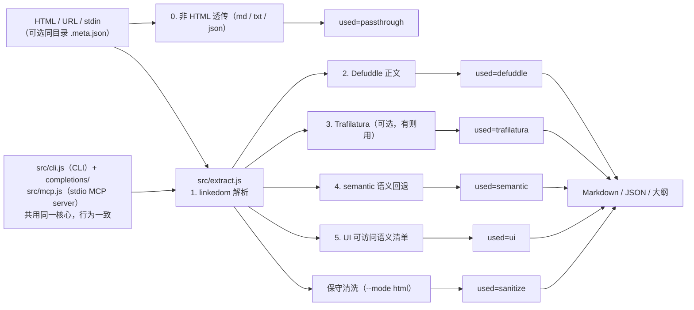

# htmlmini v2

把 HTML 网页（含大量 CSS/JS 样板）压成"核心骨架"，以 Markdown 输出，专为 **LLM 总结省 token** 设计。实测本地设计稿：原始 24KB~99KB → 提取后 300B~1.3KB，**节省约 75%~99.5%**。

- 引擎链（`auto` 默认）：**非 HTML 透传** → **Defuddle** 正文提取 → **Trafilatura**（可选，见下）→ **semantic** 纯 JS 语义回退 → **UI 组件清单**（面板/仪表盘/设计稿；面板/表单页 UI 信号多且 Trafilatura 抽出的文字不长时，Trafilatura 让位给 UI 清单，避免拿去导航/表头碎片）。`text/plain` 直接返回的 markdown（如某些 gitee 链接）、纯文本、JSON 不硬抽，原样返回（`used=passthrough`）。
- 双形态交付：**CLI**（任意 harness/终端可用）+ **MCP server**（opencode / Claude / Cursor 等当工具调用），共用同一核心，行为一致。
- 需要"结构"而不是"摘要"时用 `--mode html`：保守清洗后的 HTML（去脚本/样式/表观属性，保留完整 DOM 与文本顺序），默认按 `compact` 排版压掉源码缩进与空行，比 markdown 费 token，但看表格、嵌套层级与表单初始态时不必回读原始 HTML。`--pretty` 重排为可读缩进，`--prune-empty` 额外剪掉清洗后变空的容器。

## 为什么是这个选型（结论）

JS 静态提取这条线上，[Defuddle](https://github.com/kepano/defuddle)（Obsidian 团队维护）已经是上位选择：相对 Mozilla Readability，对代码块/LaTeX/现代 SPA 更宽容，还有站点抽取器注册表。没有直接 drop-in 更强的 JS 方案。

| 工具 | 定位 | 相对 htmlmini |
|---|---|---|
| `Mozilla Readability` / `@extractus/article-extractor` | 经典正文提取 | 下位：保守启发式，代码块/SPA 易损坏 |
| `Trafilatura`（Python） | 基准测试精度冠军，多语言/元数据强 | 正文质量上位，已作为**可选二级引擎**接入（`pip install trafilatura` 后自动生效，缺席静默跳过；装在非 PATH 环境时用 `--python-bin` / `HTMLMINI_PYTHON` 指定解释器） |
| `Microsoft MarkItDown`（+ `markitdown-mcp`） | 通用文件转 Markdown（pdf/docx/xlsx/html…） | 更通用但 HTML 去样板弱于 Defuddle；office/pdf 类任务请用它，不归 htmlmini 管 |
| `Playwright MCP` / Firecrawl / Jina Reader | 浏览器渲染 + 可访问树 / 托管提取 | 动态 JS/强反爬场景的上位，但重（浏览器/付费服务/联网）；htmlmini 只做静态，动态页先走 `resilient-browser-fetch` 渲染再喂给 htmlmini（见"流水线"） |
| `pandoc` / `html2text` / `inscriptis` | 格式转换 | 只转格式不去样板，省 token 远不如 |
| `web_fetch` / `web_search`（harness 内建） | 通用抓取与搜索 | 泛抓取兜底：零依赖、保留完整 DOM 顺序，但不剥样板也不做组件清单；取舍见下节 |

UI/面板页是所有静态提取器的共同短板：没有"文章正文"可抽。v2 的做法是**按可访问语义**输出组件清单（标题/地标/表单字段/按钮/表格/图片 alt/链接/文本），只认语义标签与 ARIA，不再用 `class*="btn"` 之类正则猜样式类。

### 与 harness 内建 fetch 的取舍

harness 自带的 `web_fetch` / `web_search` 是通用抓取：不剥样板、不做组件清单，好处是零依赖且文档顺序完整。同一份产品页（约 875 KB 的营销页）多通路实测：

| 通路 | 体积 | 首屏/品牌墙 | 定价卡 | FAQ 正文 | 导航/页脚样板 | 调用与复用 | 依赖 |
|---|---|---|---|---|---|---|---|
| `--mode ui` | ~17 KB | 有 | 有（已归一化） | 无（只有标题） | 中 | 抓取 + 落盘 + 按需逐视图提取 | 本地 CLI 或 MCP |
| `--mode markdown` | ~42 KB | 无 | 无 | 最完整 | 低 | 同上 | 同上 |
| `--mode html` | ~106 KB（`--attrs none` 约 91 KB） | 有 | 有（跨 span 拆开） | 有 | 中 | 同上 | 同上 |
| harness `web_fetch` | — | 有 | 视页面：内容在静态 DOM 时能取到；tab 面板/layer 模板里的块漏 | 部分（每组首答） | 高（整站导航+页脚） | 1 次调用、零依赖、不落盘 | 内建 |

取舍：判据不是页面类别，而是**目标块在不在静态 DOM 里**。内容随 HTML 一并下发（服务端渲染/内联）时，内建 fetch 也能拿到首屏与卡片，只做正文摘要就够用，且一次调用、零依赖；块藏在 tab 面板、layer 模板或客户端渲染里时才必然漏，用 htmlmini。要取数、要组件清单（按钮/地标/表单/图片 alt）、要结构或要落盘复用同样用 htmlmini——`ui` 打底，缺长正文再按锚点切片补一次 `markdown`。注意内建 fetch 会重复吐轮播等模板块、带 `data:` 占位图与整站页脚，这些噪声也计入 token 成本。
需要 htmlmini 处理同一页时，仍优先 `htmlmini <URL>` / `--render` 或 save_page 直接落盘：内建 fetch 返回的是已转换文本（或 `format=html` 的源码），落盘要绕一遍模型上下文，也不带同目录 `<name>.html.meta.json`（页面 URL 会丢）。

## 安装

```bash
cd skills/htmlmini
pnpm install --frozen-lockfile
# 无需全局安装：用 pnpm exec htmlmini 或 node src/cli.js 直接跑
```

没装 pnpm 时不必先全局安装：Node 自带 Corepack，在项目目录执行 `corepack pnpm install --frozen-lockfile` 会按 `package.json` 的 `packageManager` 取对应 pnpm 版本（首次会下载 pnpm 本体，其来源独立于 npm registry）。需要 `pnpm` 命令常驻时再用 `corepack enable`（写 Node 安装目录，Windows 下可能需要管理员）或 `npm i -g pnpm`——装全局工具、改 PATH 属机器变更，先向用户说明命令与影响再执行。

确实拿不到 pnpm 时，`npm install --no-package-lock --omit=dev` 不读 `pnpm-lock.yaml`，依赖版本可能与锁定不一致，只能作临时通路。国内镜像与 Corepack 下载源见 `network-access` 的 [依赖下载](../network-access/references/dependency-downloads.md)。

可选增强：`pip install trafilatura`（`auto` 链自动检测，有则用，无则跳过，不报错）。

补全：`htmlmini --completion bash|powershell`，或直接引用 `completions/` 下同名文件。

## CLI 用法

选项与示例以 CLI 自带帮助为准：`htmlmini --help`（清单用 `--list-modes` / `--list-extractors`）。
代理路由、日志级别与各阶段体积的读法见下节。

## 日志与进度

进度一律走 **stderr**（stdout 只放载荷，`| htmlmini - -t` 这类管道不会被污染），阶段标签沿用 `htmlmini: [阶段] …`：

```console
$ htmlmini "https://github.com/features/copilot" --mode html --pretty -o copilot.clean.html
htmlmini: [read] fetching https://github.com/features/copilot [proxy: http://127.0.0.1:7890 (HTTPS_PROXY)]
htmlmini: [read] https://github.com/features/copilot 855.2 KB in 1.21s
htmlmini: [parse] dom 55ms
htmlmini: [extract] used=sanitize attrs=semantic format=pretty 103.5 KB in 25ms
htmlmini: [format] pretty 200.0 KB in 41ms
htmlmini: [write] copilot.clean.html 200.3 KB (total 2.24s)
```

`[proxy: …]` 说明这次抓取的实际路由与**来源**，排查"代理到底生效没"先看它：

| 显示 | 含义 |
|---|---|
| `http://127.0.0.1:7890 (HTTPS_PROXY)` | 走代理，来自环境变量（`HTTP_PROXY`／`HTTPS_PROXY`／`ALL_PROXY` 按目标协议挑，https 优先 `HTTPS_PROXY`） |
| `http://127.0.0.1:7890 (--proxy)` | 走代理，来自命令行 `--proxy`（覆盖环境变量） |
| `direct (NO_PROXY)` | 环境里有代理但被 `NO_PROXY` 豁免 |
| `direct (--noproxy)` | 命令行强制直连，忽略环境 |
| `none` | 没有任何可用代理，直连 |

凭据不落日志（`http://user:pw@host:port` 只显示 `http://host:port`）；`--render` 回退时 `[render] engine=…` 行同样带 `[proxy: …]`，save_page 通路在无代理时显示 `none, render script discovers its own`（渲染脚本自带一层代理探测）。

| 级别 | 开关 | 内容 |
|---|---|---|
| `quiet` | `--quiet` | 只剩错误（错误不受级别影响） |
| `info`（默认） | — | 上述阶段级进度：每段耗时与体积 |
| `debug` | `--verbose` | 追加细节：source/contentType/proxy/render、引擎链结果、`reduction%`、标题 |

级别也可用环境变量 `HTMLMINI_LOG=quiet|info|debug` 预设，CLI 开关覆盖环境变量；MCP 侧只认环境变量。慢的阶段（网络抓取、`--render` 回退、`pretty` 重排）都会先报开始再报耗时，所以长时间等待不会静默。

## 与 resilient-browser-fetch 的流水线

静态抓取先跟随环境代理、403/5xx 自动补一次浏览器头；仍失败时两种走法：

```bash
# 一条命令（静态优先，403/5xx 自动回退渲染；cloak 不必接。
# 通路选择：save_page 有求解引擎（scrapling/cloak-cdp）、或要 --headful、或本机无 Chrome 时走 save_page；
# 层 1（playwright/patchright）与 Chrome 同为"只渲染不求解"，此时优先零依赖 Chrome，崩了再回退 save_page）
htmlmini "https://example.com/app" --render --proxy 'http://127.0.0.1:<port>' --json

# 浏览器选择（Chrome 通路）：显式 --chrome-bin / HTMLMINI_CHROME_BIN 优先，
# 否则自动探测——PATH（google-chrome、chrome、chromium 等）→ 系统常用路径 →
# Playwright 浏览器缓存（ms-playwright，完整版优先、无头壳兜底，取版本最大者；
# 自定义缓存位置走 PLAYWRIGHT_BROWSERS_PATH）。实际用了哪个看
# `htmlmini: [render] engine=… src=… [proxy: …]` 日志。

# 首次人工验证（save_page 通路开有头窗口，需要层 >= 1 引擎；Chrome 通路不支持有头）
htmlmini "https://example.com/app" --render --headful

# Python 环境选择（save_page 与 Trafilatura 都靠它）：默认 PATH 的 python/python3，
# 往往不是装了 playwright/scrapling 的环境（conda/venv 常见）。指定后不回退、指错即报错：
htmlmini "https://example.com/app" --render --python-bin 'C:\Users\me\.conda\envs\scrapling\python.exe'
# 懒人版：扫一遍本机（conda/venv/uv/PATH），自动挑一个具备层 >= 1 引擎的解释器
htmlmini "https://example.com/app" --render --python-bin auto
# 或 export HTMLMINI_PYTHON=<解释器路径|auto>；渲染失败时错误信息也会点名可用的解释器。
# 关闭扫描：HTMLMINI_ENV_SCAN=0；手动排查：
python ../resilient-browser-fetch/scripts/check_environment.py --list-envs --require-stealth

# 手工两步（渲染产物旁的 <name>.html.meta.json 会被自动利用）
python ../resilient-browser-fetch/scripts/example_save_page.py "https://example.com/app" --out app.html --proxy 'http://127.0.0.1:<port>'
htmlmini app.html --json
```

连续/成批多页不要循环调 `htmlmini URL --render`——每页一次浏览器创建/销毁，
又慢又多新指纹，`--render` 只适合单页/零星几页。同站多页走
`resilient-browser-fetch` 的批量会话（见其 `references/batch-workflows.md`：
单浏览器预热屏障 + 会话复用 + 受限并发），落盘后再逐个 `htmlmini_extract_file`。
临时 profile 默认随会话关闭自动清理；只有跨重启保留人工验证才用专用
`--profile-dir`（会积累缓存涨磁盘，不跨进程共用，用后确认再删）。

`--render` 只在静态 403/5xx 时触发（404/超时/断网直接抛错）；
渲染日志以 `htmlmini: [render]` 为前缀实时打到 stderr（子进程经 `-X utf8` + `PYTHONUTF8=1` 强制 UTF-8 输出；Windows 控制台查看中文时按 powershell-pitfalls 的 UTF-8 模板设置输出编码）。`save_page` 的真实 URL 即原 URL，直接提取即可。

## MCP 接入

启动：`node <仓库>/skills/htmlmini/src/mcp.js`（stdio）。六个工具：3 个正式名 + 3 个旧拼写别名（`htmmini_*`，v0.1 兼容保留）。

| 工具 | 说明 |
|---|---|
| `htmlmini_extract_file(path, mode?, extractor?)` | 提取本地 HTML 文件（含渲染后产物） |
| `htmlmini_extract_url(url, mode?, extractor?, proxy?, render?, render_timeout_ms?)` | 抓取并提取远程 URL（静态抓取：跟随环境代理，403/5xx 补一次浏览器头；`render` 为 true 时静态 403/5xx 自动回退浏览器渲染；动态页也可走上面流水线）。`headful` / `chrome_bin` / `python_bin` 同样可在 MCP 上传入 |
| `htmlmini_extract_html(html_content, mode?, extractor?)` | 就地清洗一段已抓取的 HTML 字符串 |

工具参数与 CLI 的 `mode` / `extractor` / `attrs` / `format` / `prune_empty` 同名同取值，具体取值以 `htmlmini --help` 与工具 schema 为准。

opencode（`opencode.json`，路径按本机仓库位置改）：

```json
{
  "mcp": {
    "htmlmini": {
      "type": "local",
      "command": ["node", "<仓库>/skills/htmlmini/src/mcp.js"],
      "enabled": true
    }
  }
}
```

Claude Desktop / Cursor（`claude_desktop_config.json` / Cursor MCP 设置）：

```json
{
  "mcpServers": {
    "htmlmini": {
      "command": "node",
      "args": ["<仓库>/skills/htmlmini/src/mcp.js"]
    }
  }
}
```

Claude Code：

```bash
claude mcp add htmlmini -- node <仓库>/skills/htmlmini/src/mcp.js
```

## 架构

入口有两个（输入与调用方各一），共用同一核心；`auto` 链按序取第一个可用结果：



`--json` 的 `used` 标明实际命中的引擎，`requested` 标明请求的引擎，便于判断输出性质与排查。

## 自检

```bash
pnpm test                         # smoke 43 + MCP 自检 + 可靠性 115，全内置合成输入与本地回环，无外部网络依赖
node tests/test-batch.mjs <目录>  # 本地 HTML 目录批量抽查（fixture 不入库）
```

远程抓取默认 30s 超时（`fetch timeout after …`），终端裸跑无管道时直接提示而不挂等 stdin。抓取跟随 HTTP_PROXY/HTTPS_PROXY/NO_PROXY（`--proxy` 覆盖、`--noproxy` 强制直连）；403/5xx 自动补一次浏览器头重试，仍失败在状态码后带下一步指引，挑战特征会点名，429 遵守冷却。

## 从 v0.1 迁移

- MCP 工具改名 `htmmini_*` → `htmlmini_*`，旧名保留为别名，已配置的客户端不用改。
- 新增 `--mode/--extractor/--completion`，原有单字母 flags 全兼容。
- 实现体已收进本仓库（`src/` + `package.json` + `tests/` + `completions/`），MCP 配置里的绝对路径请改为 `<仓库>/skills/htmlmini/src/mcp.js`；旧 `Desktop/code_demo/htmlmini` 副本可删除。
- UI 清单不再认样式类：只靠 `class="btn"` 标识的"按钮"不会再进 `## 按钮`（会出现在 `## 文本`），请用 `<button>` 或 `role="button"`。

免责声明：Defuddle 与 linkedom 均以 Apache-2.0 / MIT 开源，本封装代码位于 `src/`，Trafilatura 为可选外部依赖（GPL-2.0，仅在用户自行安装时调用，不随本仓库分发）。
