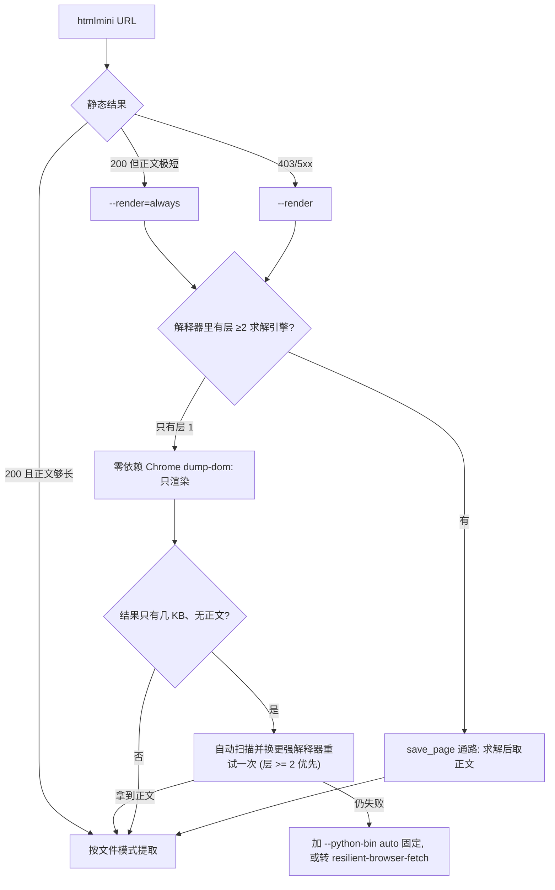

# 使用案例：按页面类型与症状取命令

`SKILL.md` 保留使用边界、模式选择、调用方式与症状分流；本文件给"具体怎么做"。选项、默认值与完整清单以 `htmlmini --help` / `--list-modes` / `--list-extractors` 为准，这里只写场景、前提和 help 未覆盖的坑。

命令里的 `<URL>`、`page.html` 是占位符；同一 URL 只联网抓一次，后续各模式复用已落盘的文件。

## 索引

| 场景或症状 | 案例 |
|---|---|
| 文章、博客、文档 | 1 |
| 营销 / 产品 / 定价页，要首屏与定价卡 | 2 |
| 面板、仪表盘、设计稿 | 3 |
| 静态 200，但正文要等客户端水合 | 4 |
| 输出只剩区块标题（手风琴 / 折叠面板） | 5 |
| 静态 403/5xx 或出现挑战特征 | 6 |
| 同站多页批量 | 7 |
| 超长页面只要大纲 | 8 |
| 要表格 / 嵌套 / 表单初始态 | 9 |
| 输入是 markdown / 纯文本 / JSON | 10 |
| 页面由后端接口供数，要完整字段 | 11 |
| 论坛 / 评论区 / 列表页，首屏不是全部 | 12 |
| 自动化全被拦，但普通浏览器能打开 | 13 |

## 1 文章、博客、文档

- 命令：`htmlmini "<URL>" -o page.md`
- 预期：`[extract] used=defuddle`（装了 Trafilatura 时可能 `used=trafilatura`）。
- 坑：首页、列表页、搜索页跑默认 `markdown` 只会得到导航与标题堆叠，换具体文章 URL。
- 坑：`used=ui` 说明页面被判成面板型（UI 信号多、正文短），先确认 URL 对不对，再考虑 `-u` 是否更合适。

## 2 营销 / 产品 / 定价页

两种视图互补，不是替代：

```bash
htmlmini "<URL>" -u -o page.ui.md        # 首屏标题、CTA、定价卡、按钮、链接
htmlmini "<URL>" -m -o page.md           # 长正文（FAQ、描述），首屏与定价卡常被当样板剔除
```

- 预期：`ui` 里有首屏标题与定价卡；`markdown` 里有长段落。
- 坑：只跑 `markdown` 会从第一张功能卡开始，首屏标题与全部定价卡都不在输出里。
- 坑：卡在 tab 面板或模板里的块（定价卡常见）正文引擎当样板丢，`ui` 与 `html` 能拿到。
- 坑：`ui` 是清单，正文类文本只到标题；要完整描述还是得 `markdown` / `text`。
- 坑：价格常把小数点做成 CSS 生成内容（`<span class="cents">00</span>` + `.cents::before{content:"."}`），DOM 文本只有 `100`。htmlmini 会把这种短标点并入文本（`stats.cssGenerated`），但外链 CSS 只在浏览器渲染通路或带 `.meta.json` 的落盘文件上抓取；纯本地 HTML 只读内联 `<style>`。
- 取价格、库存这类字段时，优先以页面自带的结构化数据（`meta[itemprop=price]`、JSON-LD、接口 JSON）为准；htmlmini 的文本是"渲染后可见文字"，不保证每个数值都完整。
- 体积量级（同一份营销页实测）：`ui` ≈17 KB、`markdown` ≈42 KB、`html` ≈106 KB、`html --attrs none` ≈91 KB。只作量级参考，随页面变化。

## 3 面板、仪表盘、设计稿

- 命令：`htmlmini dashboard.html -u`
- 输出：标题 / 地标 / 表单字段 / 按钮 / 表格 / 图片 alt / 链接 / 文本清单。
- 预算按**去重后**条数计（标题 100、表单字段 100、按钮 100、链接 30、图片 30、文本 200），文本条目另有单条长度上限（默认 150 字符）。
- 症状"末尾停在半句"或页面尾部整块缺失（定价卡只到中间一档、FAQ 正文没进来）：按锚点切片段再喂一次——从目标区起始标记前的 `<` 切到其后的 `>`，存成片段文件后 `htmlmini 片段.html --mode ui`。这是把片段交给提取器，不是手写正则抠原文，只用于确认漏内容后补齐。
- 坑：长段落（商品描述、FAQ 正文、条款）默认整条不收，输出末尾会写明省略了几条；要它们用 `--text-max 0`，或改 `markdown` / `text`。

## 4 静态 200，正文要水合

典型是客户端渲染的详情页：静态抓取返回 200，但 `Details` / `Ingredients` / 参数区只有标题没有正文，`ui` 与 `markdown` 都缺。

- 判据：**渲染后 DOM 有没有**，不是"原始 HTML 有没有"。
- 命令：`htmlmini "<URL>" --render=always -m -o page.md`（MCP `render:"always"`）。
- 预期日志：`[read] … via browser render`，以及 `[render] engine=… [proxy: …]`。
- 不加 `--render` 时，静态 HTML 往往只有应用壳 / 离线页（正文几十字节）。htmlmini 会在正文 < 200 字符且 HTML ≥ 5 KB 时报错并提示 `--render=always`（退出码 1），不再把壳当正文；确认页面本来就这么短才加 `--allow-empty`，`title` / `skeleton` 不触发该检查。
- 坑：默认 `--render` **只对静态 403/5xx 回退**；静态 200 的页面它仍走静态抓取，不水合，很容易误判成"页面没写"。
- 坑：渲染后 `ui` 仍缺长正文，通常不是渲染失败，而是 `ui` 的单条长度上限——换 `markdown` / `text` 或加 `--text-max 0`。
- 要多次复用：加 `--save-html page.html` 把这次提取实际用到的原文（渲染后 DOM）与该页 URL（写进同名 `page.html.meta.json`）一起落盘；之后 `htmlmini page.html -m` / `-u` 各视图都读这个文件，不必反复启浏览器（单次渲染通常几十秒）。
- 坑：**不要拿 `--mode html` 的清洗产物当复用文件**。清洗掉 class/id/role 后样板剪裁会变、链接也失去 URL 基准：同一页直抓得 1313 字符 markdown，改用清洗产物得 2363（多出楼层操作条、分页、时间戳等），`--attrs none` 时 `ui` 清单从 2605 字符掉到 1557。

## 5 输出只剩区块标题

手风琴、标签页、折叠面板的标题在 DOM 里，正文只在数据里。**不要**据此写成"页面未提供"。按序排查：

1. 静态 DOM：目标文字是否真在剥掉 `<script>` 后的 HTML 里；
2. JSON-LD：`application/ld+json` 常带明文摘要（标题、短描述、价格、库存），成本最低；
3. 内联 state：`<script type="application/json" id="…">` 的框架状态缓存，通常是完整正文所在。

要点：

- 这些数据都在 `<script>` 里，**任何模式的输出都不含它们**（`--mode html` 也整棵删 `script`），所以"输出里没有"不等于"页面里没有"。
- 整块 percent-encoded 时开头是 `%7B%22`（`%22` 是引号、`%20` 是空格），`json.loads` 会直接报错，须先 `unquote()` 一次再解析；出现 `%2522` / `%2520` 才是双层编码。
- 同一份正文可能存两份：JSON-LD 短版（SEO 用）与 state 长版，按所需长度选。
- 取法是从落盘 HTML 里按 id / type 单独取出对应 `<script>` 块（只取该块），不读原始 HTML 全文。
- 先按案例 4 渲染一次再判断：如果水合后 DOM 已有正文，直接 `markdown` / `text` 即可，不必碰内联 state。
- 如果页面是 SPA，渲染后仍只有展示值或目标字段缺失，且上面两处都没有完整数据，转案例 11 查页面自己的后端接口；不要继续在整份脚本里漫搜。

## 6 静态 403/5xx 或挑战特征

- 一条命令：`htmlmini "<URL>" --render`——静态优先，403/5xx 才回退浏览器渲染，再按文件模式提取。
- 渲染链：save_page（本机有层 ≥1 引擎且更合适时）→ 系统 Chrome 无头 `dump-dom`（零依赖）→ 友好报错。实际通路看 `[render] engine=…`。
- 通路选择：save_page 有求解引擎（scrapling / cloak-cdp）、需要 `--headful`、或本机没有 Chrome 时走 save_page；层 1（playwright / patchright）与 Chrome 同为"只渲染不求解"，此时优先零依赖 Chrome，Chrome 崩了再回退 save_page 重试一次（错误里两段都会出现）。
- save_page 与 Trafilatura 都跑在 Python 解释器上，默认取 PATH 的 `python` / `python3`，**往往不是装了 playwright / scrapling 的那个环境**（conda / venv 常见）。未显式指定时，渲染失败（挑战空壳 / 缺引擎 / 引擎报错）会自动扫描本机、换更强的解释器重试一次（层 ≥2 优先），日志 `[render]` 会打印两次用的解释器；显式路径不自动换、指错直接报错。也可直接 `--python-bin <解释器>` / MCP `python_bin` / `HTMLMINI_PYTHON`，或 `--python-bin auto`（或 `HTMLMINI_PYTHON=auto`）固定为扫描结果。`HTMLMINI_ENV_SCAN=0` 关闭扫描。
- `--headful` / `headful:true` 只用于首次人工验证，需要 save_page 通路且有层 ≥1 引擎；Chrome `dump-dom` 不能开窗。
- 404 / 超时 / 断网直接抛错，不烧浏览器时间。
- 坑：渲染通路选到零依赖 Chrome（日志 `[render] engine=chrome-dump`）时只渲染、不求解。目标站点有挑战特征时拿到的是挑战空壳（几 KB），htmlmini 会直接报 `rendered page still looks like a challenge`（不再误报成"像客户端渲染壳"）；按提示换求解通路，`--allow-empty` 可强行取回空壳排查。
- 已知某 origin 需要更高层（长期被 Managed Challenge 拦）时，用 `--render-engine scrapling`（或 `cloak-cdp` / `playwright`）钉住：显式指定后 save_page 只用该层、不再自动升档，缺件或失败直接报错；好处是省掉每次注定失败的 static / playwright 尝试，代价是没有升档兜底。
- 抓取失败时错误里会点名本机代理登记（`~/.config/proxy-resources.json`）的候选入口：htmlmini 不自动读登记，按提示显式 `--proxy` 或设 `HTTPS_PROXY`；404/410 不带这条提示（资源级结论，换出口不会变）。
- 取不到正文时先让 save_page 通路接管：默认已会自动换更强的解释器重试一次；仍失败时加 `--python-bin auto`（或会话级 `HTMLMINI_PYTHON=auto`）固定为扫描结果，或按 `resilient-browser-fetch check_environment.py --list-envs` 指名层数更全的那个解释器（通常是装了求解引擎的那一个）；默认 PATH 上的 `python` 常只有层 1，被判为"只渲染"而退回 Chrome。本机确实只有层 1 时 save_page 与 Chrome 等价，改走 `resilient-browser-fetch`（需要时 `--headful` 人工验证）。
- 手工两步（存量或排查）：先用双路对照（直连 + 代理并行；登记已有可用代理时直接用登记条目）确定可用路线并落盘，再 `htmlmini page.html`；不按 URL 重抓（要留下这次抓到的原文，加 `--save-html <路径>`：校验之前就落盘，挑战空壳报错时也能留下）。

通路与失败分流：



`--headful` 或本机没有 Chrome 时也走 save_page 通路。

## 7 同站多页批量

- 不要循环调 `--render`：每页一次浏览器创建 / 销毁，又慢又多新指纹。
- 走 `resilient-browser-fetch` 的批量会话（单浏览器预热屏障 + 会话复用 + 受限并发）落盘，再逐个 `htmlmini <file>`；渲染后 HTML 同目录的 `<name>.html.meta.json` 会被自动利用，不用手传 URL。
- 详见 [batch-workflows.md](../../resilient-browser-fetch/references/batch-workflows.md)。

## 8 超长页面只要大纲

- 命令：`htmlmini page.html -s`（或 `--mode skeleton`）。
- 输出：标题层级 + 表格 + 代码块语言，用于先摸结构再决定提取哪块。

## 9 要结构而不是摘要

- 命令：`htmlmini page.html --mode html`
- 默认 `--attrs semantic`（保 `href/src/alt/colspan/rowspan` 与表格 / 表单状态）、`--format compact`（压掉源码缩进与空行）。
- 更小：`--attrs none`、`--prune-empty`；更好读：`--format pretty`。
- 坑：清洗产物会重排（doctype 被提到最前），**不是**浏览器真实 DOM；写选择器 / 字段契约仍要回原始 HTML 或渲染后 DOM。

## 10 非 HTML 输入

- markdown / 纯文本 / JSON 在任何模式下原样透传（`used=passthrough`），标题取首个 `#` 或首行。
- 不要指望对 markdown 做抽取；需要正文摘要请直接读输入。

## 11 后端接口 / XHR 数据源

页面是 SPA 或应用壳，静态 HTML 只有配置和脚本；渲染后只有展示字段，或价格、库存、规格、描述等字段不完整、精度可疑。商城详情页、预约页、后台面板都常见。典型信号：静态 HTML 可见文本很少、渲染后字段仍不齐、Network 面板里有返回 JSON 的请求。页面展示已够回答且无精度疑问时不必挖接口——多一条链路就多一份维护成本。

1. 先用案例 2 / 4 提取一次（静态 403 先按案例 6 处理），列出已得字段和缺失字段，确认缺的确实不在可见内容里。
2. 从落盘 HTML 找接口入口：`init_config`、`window.__*__`、`meta[name$="/config/environment"]`、脚本里的 `apiOrigin` / `apiPath` / `baseURL`。
3. 从应用脚本找资源路径：按业务方法名搜（如 `getProduct`、`/products/`），或用浏览器 Network 面板看页面自身发出的 XHR/fetch。优先复用页面真实请求的 URL、方法和租户/门店参数，不猜路径；GraphQL 端点记录 operationName 与变量，不重放 mutation。
4. 用同一路线和必要头请求：`User-Agent`、`Accept`、`Accept-Language`、`Referer` / `Origin`；需要登录的接口带当前会话已有的 Cookie/Token，不绕过授权。
5. 用接口 JSON 核对页面值。字段缺失、批量取数或金额精度有疑问时以接口为准；页面文本只作展示校验。

例：商城详情页的静态 HTML 只有配置和脚本；从应用脚本里找到商品详情请求 `/products/{id}`，按页面请求带 `Referer` 取回 JSON，价格、库存、分类等字段比渲染文本完整。

| 做法 | 能拿到 | 代价与风险 |
|---|---|---|
| 渲染后 DOM（`--render=always` + `ui` / `markdown`） | 用户可见字段与页面结构 | 每页启浏览器，慢；格式化文本可能丢精度；字段以展示为准 |
| 原始 HTML 选择器 / 正则 | 服务端渲染的字段 | 快；SPA 壳没有数据；结构一变就失效 |
| JSON-LD / 内联 state | SEO 摘要或首屏缓存 | 零额外请求；字段常被裁剪，未必有完整规格 |
| 后端接口 JSON | 完整、带类型的业务字段 | 需发现端点与租户/鉴权参数；接口不是公开契约，可能变动 |

- 先确认接口对应当前页面和当前门店/地区；同一商品在不同门店的价格、库存和促销可能不同。
- 金额单位、税费、按个/称重、促销价与常规价要读字段名，不按显示文本猜。
- 页面 403 而接口能取到数据，说明至少接口侧可访问，不等于数据不存在；别把 403 写成“页面没提供”。
- 接口可能需要登录或付费权限；只使用当前会话已有授权，不抓取或复用他人 token。
- 接口可能返回页面没展示的内部字段（成本价、内部编码）；只取回答所需字段，不整包倾倒。
- 只采集当前用户有权访问的数据；遵守站点条款、robots 与频率限制，不用接口绕过登录、付费墙或权限。
- 批量脚本要容错字段缺失和类型变化，记录实际接口与抓取时间；不要把一次接口形状当成长期契约。

## 12 论坛、评论区、列表页：首屏不是全部

正文、评论区、列表项按滚动或分页懒加载，首屏只含前若干条。

- 不要用渲染后的节点数当覆盖度：例，渲染 DOM 里 7 条评论，站点自己的接口报 `posts_count: 111`，差一个数量级。
- 先取站点自身总数：分页接口或页面内计数（例：Discourse 的 `/t/<id>.json` 给 `posts_count` 与完整 `post_stream.stream`，`?page=N` 取后续页）。这些是同源资源，与主目标走同一路线、同一会话，不为每个端点新开浏览器。
- 只做摘要时在结果里写覆盖范围（如“覆盖前 7 楼 / 共 111 楼”）；要全量按[案例 7](#7-同站多页批量)用会话批量逐页取。

## 13 自动化全被拦，但普通浏览器能打开

同一 URL，静态 403、无头渲染只拿到错误壳（“There was an error processing your request.”、“Powered and protected by”），而人在同一个浏览器里能正常打开、刷新、看多个页面。

- **这不是“再换个引擎”能解决的**：`--render` 的零依赖 Chrome 与层 1 引擎都是“先接入调试器、再导航”，在这类站点会一律被拦。差别在**接入时机**——页面加载早期接入会被 WAF 判成自动化，渲染完再接入同一个浏览器就能读。
- 交 `resilient-browser-fetch` 的晚接入引擎：`--engine chrome-late --settle-ms 12000`（先让页面自然加载，再接入读已渲染 DOM），落盘后 `htmlmini <file>` 提正文。
- 定位时**一次只改一个变量**，把结论收敛到单一维度：
  1. 同一会话里首页 200、深链 403 → 不是首页路由的问题，是客户端或时机；
  2. 全新 profile 与可信 profile 结果相同 → 不是 cookie、账号或历史；
  3. 换出口（直连 / 另一国 / 另一 ASN）结果相同 → 不是 IP 拉黑；
  4. 页面加载完再接入 → 放行 → 是接入时机。
- 坑：把**一次**成功当成结论。同一个控制面换新 profile、换出口、隔一段时间复测可能又回到拦截页；站点风控随频次动态变化，结论必须同条件复测。
- 完整判读与排查路径见 `resilient-browser-fetch` 的《检测层与引擎选择》——实战判读一节。

## 通用坑

- 同一 URL 只联网抓一次，换视图不是重抓的理由。
- 判断这次到底命中哪个引擎，看 `--json` 的 `used`；记录结果出处时一并记 `version`（`htmlmini --version`）。
- `ui` 与 `markdown` 互补：前者有首屏与卡片但正文只到标题，后者有长正文但剔除首屏与定价卡。
- 价格/计量别只看文本：CSS `::before/::after` 的短标点已并入，但图标字体、`url()`、`attr()`、跨源样式与纯静态本地文件仍可能缺字符；核对数值用结构化数据或原始 DOM。
- 需要排查"是不是内容根本没下发"时，先看案例 4（渲染一次）再看案例 5（内嵌数据），顺序反了会白解码。
