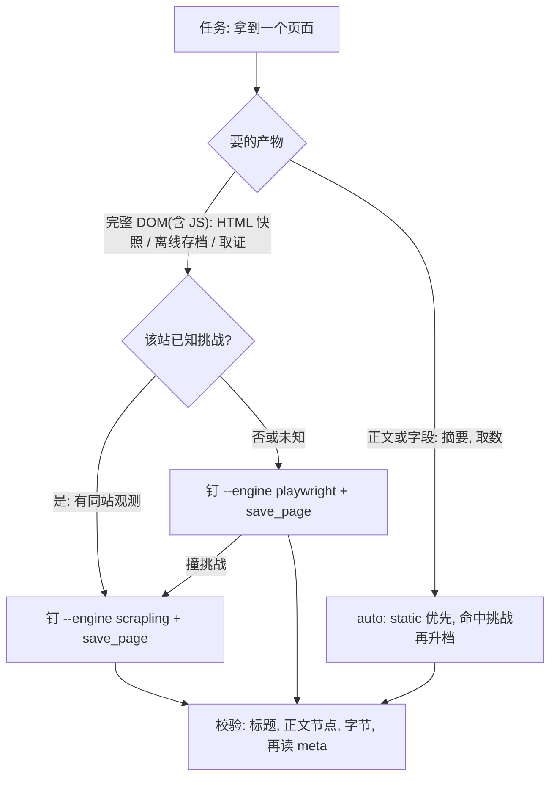
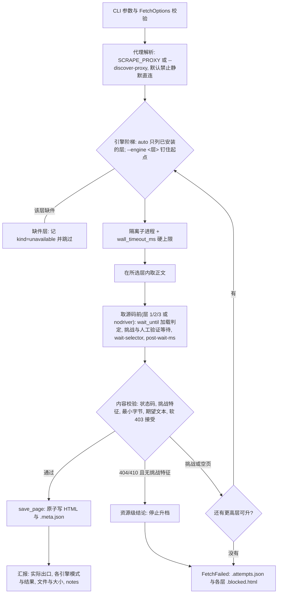

# 稳健浏览器采集

仅采集用户有权访问的公开或获授权页面。遵守目标服务条款、robots/速率限制和适用法律；不要自动执行登录、下单、账户创建、凭据测试或其他改变外部状态的操作。Cloudflare 通过与否受出口 IP、控制面/驱动痕迹、指纹、地区一致性和站点策略共同影响，不承诺通用通过率。层号表示能力档位，不是隐蔽性排名；控制面、指纹和 IP 的判断见 [检测层与引擎选择](references/detection-layers.md)。

## 先定交付物

“采集/爬取/抓取”只描述动作，不决定产物。先确认要的是哪一种，再选入口；不要把“采集产品信息”默认当成离线存档。

| 目标 | 产物 | 入口 |
| --- | --- | --- |
| 保存页面 HTML、要 JS 渲染后的正文或商品描述、图片等保留原 URL | HTML 快照：渲染后的 DOM + `.meta.json`，不落盘子资源 | CLI `resilient_fetch.py --out` 或 `save_page` |
| 导出产品字段、表格、价格、规格 | 结构化数据，不要求页面 HTML | `fetch_page` 取回后提取；字段来自接口时读接口 JSON |
| 离线打开、断网可看、图片/CSS 一起保存 | 离线存档：资源目录或单文件 | `save_page` 后 `archive_page.py` 或 MHTML |

这里说的 HTML 快照，通常指浏览器把渲染后的 DOM 序列化为 HTML 文本，再由 `save_page` 写入 `.html` 与 `.meta.json`；层 0 `static` 没有浏览器，保存的是 HTTP 响应正文，不执行 JS。序列化只把内存中的 DOM 树转成 HTML 文本，不等于写入磁盘；落盘是随后的独立步骤。它保存标记和文本，不包含 JS 运行时状态（变量、事件监听器、Canvas 像素等）。

它不是截图、搜索引擎缓存或含资源的离线存档；“网页快照”一词有歧义，本 skill 统一用“HTML 快照”。术语、序列化边界和产物对比见 [HTML 快照与序列化](references/html-snapshot.md)。

HTML 快照里的图片、字体和外部样式表/脚本仍指向原站；内联样式和脚本会留在 HTML 中。离线打开可能缺图或缺样式，但正文和 JS 渲染结果已经写入 HTML。要懒加载或点击后才出现的描述，先触发交互再取源码（CLI 的等待参数不会自动滚动或点击）；等待时用稳定的容器选择器或短文本，不要把整段易变文案当成默认成功条件。

用户只说“采集/爬取产品信息”时，先确认要字段还是 HTML 快照；提到“图片保留 URL/不用下载资源”时按 HTML 快照处理，例如“采集产品信息，图片保留 URL 即可”产出 HTML + `.meta.json`，不建资源目录，也不调用 `archive_page.py`。只有明确要离线可看或连资源保存时才做离线存档。

交付前核对：字段、HTML 快照、离线存档没有混用；用户只要求保留 URL 时，产物中不应新增资源目录，也不应把远程资源转成 data URI。

## 入口与读取顺序

先按任务选定入口，再按该行读取依赖文档。

| 任务 | 入口 | 该读 |
| --- | --- | --- |
| 抓单个页面、诊断未知站点 | CLI `scripts/resilient_fetch.py`（默认 `--engine auto`；`--help` 给短版、`--help full` 给完整选项表） | 本文件"工作流"与"引擎分层与选择" |
| 高频开关想少打字 | 长选项是主名，短选项给最常用的几个：`-o/--out`、`-p/--proxy`、`-e/--engine`、`-b/--browser-brand`（`example_save_page.py` 同款） | 本文件"引擎分层与选择"与 `scripting-best-practices` 的命令行选项约定 |
| 保存 HTML 快照、图片等保留原 URL | CLI `--out` 或 `save_page` | 本文件"先定交付物"与"示例脚本"；细节见 [HTML 快照与序列化](references/html-snapshot.md) |
| 只要标题/状态码/字节数，或供其他语言调用 | `scripts/example_extract_page_info.py`（stdout JSON） | 本文件"示例脚本" |
| 页面多于一个、需要预热/复用会话/sitemap | 三条批量会话按依赖选 | [references/batch-workflows.md](references/batch-workflows.md) |
| 层 2/3 都卡同一挑战，怀疑控制面/指纹/IP | 先做检测层判断，再选引擎 | [references/detection-layers.md](references/detection-layers.md) |
| 在 Python 进程内取页或存盘 | `resilient_fetch` 的 `FetchOptions`/`fetch_page`/`save_page` | [references/module-api.md](references/module-api.md) |
| 已保存的 HTML 要离线存档（下载/内联资源） | `scripts/archive_page.py` | 本文件"示例脚本" |
| 安装到 Agent、换机器或换系统 | [references/installation.md](references/installation.md) | 该文件，再读 [references/platforms.md](references/platforms.md) |
| 修改 `scripts/` 或 `tests/` | 直接改脚本，无封装入口 | 本文件"工作流"末段的质量门禁 |

## 工作流

先按要的结果选起点，再进下面的单次抓取流水线：



- HTML 快照和离线存档若要包含 JS 渲染结果，就要渲染后的完整 DOM，层 0 给不出，从最低层起跑属于纯浪费；确认静态正文已足够时可直接走层 0。取数才按 `auto` 从 static 起步。
- HTML 快照只写 HTML 与 `.meta.json`，图片等子资源保留原 URL；离线存档是在校验通过后再用 `archive_page.py` 或 MHTML 下载/内联资源。
- 钉住某层会失去升档兜底，代价与适用条件见“引擎分层与选择”。
- 层 2 和层 3 以同一挑战签名失败时，别默认“再加一层”；先按 [检测层与引擎选择](references/detection-layers.md) 判断是控制面、指纹还是出口/IP 问题，再决定换出口或显式试 nodriver；该文末有一次 Akamai 站点的完整判读示例。

前置：先确认已走 `network-access` 排除选路问题；普通超时/直连失败不直接启动浏览器，仅当正文为挑战/拦截特征时才用本 skill，选路结论同一任务内复用。该站已有观测记录或本次已确认挑战特征时，不必再发裸请求复现 403，直接按上图取 HTML 快照或升档（判定位置见 `network-access` 的“抓取前先查同站观测”）。

1. 如果需要将本 Skill 安装到 Codex、Claude Code、Cursor 或 Gemini CLI，先读取 [references/installation.md](references/installation.md)。依赖按引擎分层安装，**只装当前任务需要的层**：层 0（`static`）零第三方依赖，层 1 装 `playwright`+浏览器，层 2 装 `requirements-stealth.txt` 并运行 `scrapling install`，层 3 再装 `requirements-cloak.txt` 并运行 `python -m cloakbrowser install`。直接 CDP 备用（可选）再装 `requirements-nodriver.txt`，复用系统 Chrome，不需要 `playwright install`；其许可为 AGPL-3.0，商用或 SaaS 先评估。装层 2 会带入 Patchright，层 1 的默认 API 也会随之改变；做原版 Playwright/Patchright A/B 时用 `--playwright-api` 固定。层 2 的 `scrapling install` 实际调用 Playwright 的安装器，而运行时用 Patchright；装完在同一环境补跑 `python -m patchright install chromium`，并用两边的 `install --dry-run chromium` 核对 revision，避免 `Executable doesn't exist`。随后根据当前系统读取 [references/platforms.md](references/platforms.md)，选定独立 Python 3.10+ 环境；国内安装先配置下载路线，`scrapling install` 的系统依赖步骤与页面代理分开处理。环境可以由 Conda、`venv` 或 `uv venv` 管理；Linux 是默认部署目标。先运行 `uv --version`；可用时优先执行 `uv pip install --python <目标环境解释器> ...`，不可用时回退到该环境的 `python -m pip`，不要混用两个安装器修改同一环境。安装新层会改动本机环境（下载量、浏览器二进制、系统依赖）。会话或本机偏好没有禁止安装时按默认授权处理：报出缺哪层、装什么、大概多大，按任务选最小可用层直接安装并重跑，不要停在“是否安装”的请示上；只有用户已声明禁止安装，或安装涉及付费、账号、系统级改动时才先确认。不得以“本机没装该层”为由跳过，也不得因此默认改用第三方服务。
2. 运行只读环境诊断：

   ```bash
   python <skill-dir>/scripts/check_environment.py --proxy 'http://127.0.0.1:<port>'
   ```

   诊断只反映**运行它的那个解释器**。全局默认 `python` 往往只装了层 0/1，而层 2/3 装在某个 Conda/venv 里；需要某层却报缺件时，先扫一遍本机候选环境，再按建议换解释器运行：

   ```bash
   python <skill-dir>/scripts/check_environment.py --list-envs --require-stealth   # 缺层则退出码 1
   ```

   输出按可运行层数排序，标明每个解释器的管理方式（`conda:<env>`/`venv`/`system`）、可用引擎与缺项，并给出可直接复制运行的命令（含 `conda run -n <env> --no-capture-output python -X utf8 ...` 形式）。`conda run` 必须带 `--no-capture-output`，否则在 GBK 控制台上会被 conda 的捕获重印弄崩。选定环境后用该解释器运行后续所有脚本。需要整机视角（运行时、浏览器、代理入口）时先跑 [resource-inventory](../resource-inventory/SKILL.md)，它直接调用本脚本的 `--list-envs`，不另做一份环境判断。

   明确需要本地代理但未设置 `SCRAPE_PROXY` 时，可在抓取命令中添加 `--discover-proxy`，按本机登记文件中的候选依次探测。它只取**第一个**能建立 TCP 连接的候选，不验证协议与出口；命中挑战或 403 时不要据此认定站点不可达，先用 `network-access` 的 `probe_local_proxies.py` 取 `usable[]`，再对每个可用入口各发一次目标请求。端口开放只代表存在候选服务，换出口的结论要写进报告。

3. 取正文时先使用 `auto`；要 HTML 快照或离线存档时按上面的入口图直接钉层。它只把**已安装**的引擎列入顺序，按能力从低到高尝试：`static` → `playwright` → `scrapling` → `cloak-cdp`；缺件的引擎记录为 `unavailable` 并跳过，不算失败。直接 CDP 的 `nodriver` 排在最后，且只在 `--headful` 时加入 `auto`；无头 `auto` 不会尝试它。每个引擎都在隔离子进程里跑并带硬超时，被内容校验判为挑战页或空壳时再升档。服务端明确返回 404/410 且正文没有挑战特征时，`auto` 停止升档——换引擎不会改变资源级结论。静态页在层 0 就能拿到，不必启动浏览器。有引擎因缺件被跳过时，日志会提示"依赖可能装在别的 Python 环境"并指向 `--list-envs`；全部引擎都缺件时，错误信息同样给出这条排查路径。

   ```bash
   python <skill-dir>/scripts/resilient_fetch.py \
     --url 'https://example.com/product' --out './product.html' \
     --proxy 'http://127.0.0.1:<port>' --timeout-ms 300000 \
     --expect-text 'Product name'
   ```

4. 高对抗站点在无头失败后，先用 `--headful` 重试——有头窗口通常比安装新层更省，指纹敏感的站点再配合 `--real-chrome` 换真实浏览器（属指纹需要，不要求目标点名系统 Chrome）；层 2/3 可加 `--humanize`。Linux 服务器先配置 Xvfb。**层 1（playwright）现在也支持有头人工验证**：配合 `--challenge-wait-ms 300000`，脚本会打开可见窗口并在预算内轮询页面，等你手动过完验证再继续（此前层 1 会直接保存挑战页）。有头模式会先打印操作指引；无头模式若撞上挑战，日志会提示改用 `--headful` 或层 2/3。如果层 2/3 都卡在同一挑战、且怀疑目标专门识别 Patchright 控制面，可显式试 `--engine nodriver --headful`：它用系统 Chrome 直接 CDP，不求解挑战、不伪造指纹，只作为控制面备用；无头 nodriver 通常明显更弱，不建议用于反检测。**判据**：用户自己的浏览器能打开同一 URL、自动化浏览器却被拒时，出口通常不是问题，差异在控制面或指纹，直接改走 `--engine nodriver --headful`，不要先轮换代理或继续叠加 Patchright 系引擎；Akamai 一类非 Cloudflare WAF 常直接回 403/Access Denied，`solve_cloudflare` 对它无效；这种“边缘封禁”连挑战页都没有，加 `--solve-akamai` 同样无效，只能换出口——**或换客户端品牌**（见“边缘封禁可能按客户端品牌判”）。换控制面只改信号维度，站点风控随频次与时间动态变化，**任何一次通过都要同条件复测**（新 profile、换出口、隔一段时间各一次）再写进报告。**本阶梯的引擎都是“先接入调试器再导航”**；这类站点会先下发挑战页，挑战在页面加载早期判定成败，采到这个接入就判成自动化，换引擎前先试“先让挑战跑完、再接入调试器读取”，见 [检测层与引擎选择](references/detection-layers.md) 的“先让挑战跑完，再接入”。代理地区未知时不要硬编码语言和时区；已知地区时同时设置 `--locale` 与 `--timezone`，或安装 `cloakbrowser[geoip]` 后使用 `--geoip`。
5. 自动求解返回后仍停在挑战页时，使用 `--challenge-wait-ms 300000 --profile-dir <专用目录>`。有头模式允许用户在这段时间人工完成一次验证，后续运行复用 cookie/localStorage。脚本在该根目录下分别使用 `scrapling/`、`cloak/` 与 `nodriver/`，避免不同浏览器共享同一 profile。
6. 默认使用状态码、挑战特征、正文大小和最终 origin 做宽松检查；这套检查只挡明显的挑战页与空壳。**站点外壳配一句通用错误文案（如 “There was an error processing your request.”）属于软错误页，宽松检查会判成成功**：抓商品、详情、文章等具体资源时，至少加一项内容断言——目标标题或关键字段的 `--expect-text`，或主内容容器的 `--wait-selector`；命中的正文不含目标字段就按 `blocked_or_empty` 继续升档，不要把 200 当达成。这类页面命中 `site_error_shell` 特征会被直接判为拦截（Akamai 挑战页另有 `akamai_challenge`，Akamai 边缘封禁另有 `akamai_edge_block`，浏览器自身的网络错误页另有 `browser_error_page`），失败信息里会直接给出可试的下一条路线。**注意区分"被拒绝"与"挑战还没跑完"**：挑战页（`sec-if-cpt-container`、`Powered and protected by`、Cloudflare challenge-platform）表示站点还没放行，再等才有机会拿到正文（Akamai 挑战页可加 `--solve-akamai`）；标题是 `Access Denied`、正文带 `Reference #18.…` 或硬 403 则表示这条路已经走不通，Akamai 的这种情况记为 `akamai_edge_block`，要换出口而不是加求解器。**也要区分"站点自己报错"与"页面没内容"**：应用渲染失败时的 “Unable to connect to the Internet”、“Something isn't right and an error has occurred.” 属前者，多半是应用的数据接口在当前出口取不到，换出口而不是换引擎。判据是“可见文字很少 + 抱怨出现在正文开头”，正文长的页面即使挂着同样的横幅也不算。断言用稳定字段（标题、规格名、栏目名），不要把易变促销文案写成成功条件。状态码本身不足以判定拦截：HTTP 403 且正文没有拦截特征、长度达标、期望文本全部命中时，按可用内容接受并在 `notes` 记 `http_status:403:accepted_by_content`（日志会告警）；这类正文可能尚未水合，需要完整客户端渲染时显式指定 `--engine scrapling` 等更高层。其余 4xx/5xx 仍按失败处理。
7. 检查 `<输出>.meta.json` 的最终 URL、状态码、引擎、耗时、版本、哈希、`notes` 和尝试记录；失败时按 `<输出>.attempts.json` 里的 `kind` 处置：

   | `kind` 或现象 | 含义 | 下一步 |
   | --- | --- | --- |
   | `unavailable` | 该层依赖不在当前解释器里 | 用 `check_environment.py --list-envs` 换解释器，或按 installation.md 补装该层（默认授权见第 1 步） |
   | `blocked` / `blocked_or_empty` | 被挑战拦截，或只拿到空壳 | 按顺序收口：升档（已安装的更高层）→ `--headful`（必要时配合 `--real-chrome`）→ 逐个换登记中的可用出口并对目标各发一次请求 → 安装缺失的层（默认授权见第 1 步）→ 第三方正文服务（先征得同意）。每一步都记录结果，本机路线全部失败才如实报告；第三方路线要在报告里注明来源与出口 |
   | 结果状态为 404/410 | 服务端明确表示资源不存在或已删除，`auto` 已停止升档 | 先确认 URL、权限与站点可见性；在同一会话用对照页或公开接口核对，不要反复换引擎 |
   | `runtime_error` | 运行期异常（浏览器缺失、崩溃等） | 看该引擎报错，按 installation.md 补齐缺件后重跑 |
   | 达到 `--wall-timeout-ms` 仍无结论 | 硬上限用尽 | 提高 `--timeout-ms` 与 `--wall-timeout-ms`（如 300000/600000），或先排除出口问题 |
   | `<输出>.<引擎>.blocked.html` | 被拒收的正文 | 与预期文本和结构比对，判断是拦截页还是校验条件过严 |

   汇报结果时用表格汇总：本次实际出口（直连，还是哪个代理/登记名；必要时用外部 IP 检测页核对）、每个引擎的模式与结果（引擎、有无头、状态码、耗时）、最终文件与大小，以及 `notes` 里的软状态码、`control_plane`、`playwright_api`（Playwright 系引擎）、`browser_channel` 和 `headless` 等注记；不要只报模式与引擎名。浏览器引擎的 `notes` 用于区分“同层但控制面/API 不同”，例如层 2/3 的 `control_plane:patchright` 与 nodriver 的 `control_plane:direct-cdp`。

修改 Python 脚本后，使用相同的安装器安装 `requirements-dev.txt`，并在技能目录运行以下质量门禁；三条命令必须全部以退出码 `0` 完成：

```bash
python -m ruff check scripts tests
python -m pyright
python -m pytest
```

## 示例脚本

保存渲染后的 HTML 快照（只写 HTML 与 `.meta.json`，图片等资源保留原 URL）：

```bash
python <skill-dir>/scripts/example_save_page.py 'https://example.com/' \
  --out './example.html' --discover-proxy --expect-text 'Example Domain'
```

只有明确要离线打开、连资源一起保存时，才加 `--save-snapshot` 导出 MHTML；它会包含页面资源，不是“只保留 URL”的快照。

获取网页并以 JSON 打印标题、状态码、最终 URL、引擎、字节数和正文预览：

```bash
python <skill-dir>/scripts/example_extract_page_info.py 'https://example.com/' \
  --discover-proxy --preview-chars 500
```

`archive_page.py` 用于把已保存的 HTML 做成离线存档：默认拆成 HTML 加资源目录，需要单文件时加 `--single-file`。它会下载或内联资源，不是保存 HTML 快照的默认步骤；用户说“图片保留 URL”时不要调用。

```bash
python <skill-dir>/scripts/archive_page.py './page.html' --mhtml './page.mhtml' \
  --proxy 'http://127.0.0.1:<port>'
# 产出 page.archive.html + page.archive_files/（含 manifest.json）

python <skill-dir>/scripts/archive_page.py './page.html' --single-file -o './page.offline.html'
```

- 拆分模式保留 `<link>` 与 `srcset`，资源按内容哈希命名写入资源目录，HTML 与 CSS 用相对路径引用；单文件模式把样式换成 `<style>`、图片与字体转 base64 data URI，并清空 `srcset`（data URI 含逗号，srcset 按逗号切候选，会被解析错）。
- MHTML 快照由浏览器会话内的 CDP 抓取，含登录态与挑战清除后的资源；`--mhtml` 命中时不走网络，缺失的资源才回退 HTTP。层 0 没有浏览器，快照与 cookie 都不产生文件。
- 默认从同名 `page.html.meta.json` 的 `final_url` 解析相对地址，也可用 `--base-url` 指定；输入必须是 UTF-8。
- 单资产与总量上限默认 2 MiB / 30 MiB，超限或抓取失败的条目保留原 URL，并在日志与 `--json` 里给出原因；上限按去重后的资产字节计。
- 单文件模式同一图片被多处引用会重复写入 data URI，成品体积明显大于拆分模式；`<script src>` 两种模式都不内联，依赖脚本渲染的页面离线打开仍可能缺内容。

`--save-cookies` 导出 Netscape 格式 cookie 给 `--cookies` 用，适合只校验 cookie 的站点。挑战站的 clearance 不能跨 HTTP 栈复用：实测把 `cf_clearance` 交给 urllib、以及用 `curl_cffi` 做 TLS 伪装，同一 URL 仍返回 403，这类资源只能走 MHTML 快照。cookie 文件含会话凭据，不放仓库、用完删除。

任意语言可把信息示例作为子进程执行并只解析 stdout 的 JSON；抓取日志写入 stderr。Python 程序也可将 `<skill-dir>/scripts` 加入模块搜索路径，再从 `example_extract_page_info.py` 导入 `fetch_page_info()` 直接取得字典。

需要首次人工验证并连续访问多个页面时，运行有界面批量示例。它只预热一次首页，然后在同一 Scrapling context 中以最多两个 tab 抓取三个商品页：

```bash
python <skill-dir>/scripts/example_greentradingxxl_batch.py \
  --proxy 'http://127.0.0.1:<port>' \
  --output-dir './greentradingxxl-pages'
```

首次出现验证时直接在已打开的浏览器窗口中完成；不要关闭窗口或另开浏览器。该命令使用全新临时 profile 并在关闭后清理。跨重启复用时才添加 `--profile-dir './profiles/greentradingxxl'`；用户明确要求严格业务检查时添加 `--strict`。

## Python 模块调用

外部 Python 程序应优先读取 [references/module-api.md](references/module-api.md)。独立页面从 `resilient_fetch` 导入 `FetchOptions`、`fetch_page()` 或 `save_page()`；静态批量从 `static_session` 导入 `StaticBatchSession`、`StaticSessionOptions`（层 0，零依赖）；需渲染但无求解器的批量从 `browser_session` 导入 `BrowserBatchSession`、`BrowserSessionOptions`（层 1，只要 playwright/patchright）；需要渲染或挑战求解的连续批量从 `site_session` 导入 `SiteSessionManager`、`SiteSessionOptions` 和 `SiteRequest`。调用者应处理结构化异常，不要解析日志文本或模拟 CLI 参数。

模块导入无副作用，也不会调用 `logging.basicConfig()`。`fetch_page()` 仍是每次调用隔离浏览器的单页 API；连续批量任务不得直接并发调用它创建大量浏览器，应使用下面的会话预热模式。

## 批量、并发与 Sitemap

目标页面多于一个或需要访问 sitemap 时，必须读取 [references/batch-workflows.md](references/batch-workflows.md)，并按依赖分层选会话：静态正文用 `static_session.StaticBatchSession`（层 0，零依赖）；需要渲染但不需要挑战求解、或本机只有层 1 时用 `browser_session.BrowserBatchSession`（单 browser/context 多 tab，只要 playwright/patchright）；需要挑战求解用 `site_session.SiteSessionManager`。三者都先在一个会话中单路访问站点首页，完成验证并确认正常内容后，再放开多 tab 并发；前两者命中挑战页即抛 `PageRejectedError` 供升档。访问 sitemap 时使用“首页预热 → sitemap index/子 sitemap → 详情页”的顺序，不要让 sitemap 成为新会话的首个验证页面。

连续批量任务优先复用同一运行中的窗口、context 和临时 profile；多个 tab 对应受限并发，任务结束后再关闭整个浏览器。预热后的子页面先轻量导航并验证内容，检测到新挑战时才暂停队列、重新预热并启用求解重试。不要为每个 URL 或 worker 反复创建、销毁浏览器。

同一站点的对照页、接口端点（如 `.json`/`.rss`）和探针也属于多 URL 任务：合并进同一个已预热会话，按主目标 → 对照页 → 端点的顺序导航；不要为每个探针新开浏览器。遇到 404/410 先判定为资源级结论，再决定是否继续。

仅在跨进程、跨重启或需要保留人工验证成果时使用 `--profile-dir`；profile 可能积累缓存、Service Worker、IndexedDB 和 cookie，占用较多磁盘，且不得由多个进程同时打开。不传 `--profile-dir` 的临时 profile 正常退出会自行清理，异常终止则残留在系统临时目录，识别与清理见 references/platforms.md 的临时 profile 与磁盘残留一节。

## 引擎分层与选择

还有两条不属于引擎层的路线：站点放行凭据在用户自己的浏览器里时，复用那个会话比继续升层更有效；生态里的其他实现怎么比，见 [检测层与引擎选择](references/detection-layers.md) 的“另一条路线：复用真实浏览器会话”与“同类方案对比”。对比表里的方案**不是本 skill 的依赖**，不进 `auto` 阶梯。

| 层 | engine | 能力 | 依赖 | 不做什么 |
| --- | --- | --- | --- | --- |
| 0 | `static` | 直连 HTTP 取正文、状态码、重定向链；可选 TLS/HTTP2 客户端伪装 | 无（stdlib）；推荐 `curl_cffi`（socks 代理、`--impersonate`） | 不执行 JS，不求解挑战 |
| 1 | `playwright` | 无头/有头渲染、等待与交互；可用 `--playwright-api` 选择 Playwright/Patchright；`--solve-akamai` 可开 Akamai 求解 | `playwright` 或 `patchright` + 浏览器二进制 | 默认不求解挑战，指纹弱于层 2 |
| 1/备用 | `nodriver` | 系统 Chrome 上直接 CDP 渲染；有头时作为控制面备用 | `requirements-nodriver.txt` + 系统 Chrome；AGPL-3.0 | 不求解挑战、不伪造指纹；无头明显更弱；auto 仅 `--headful` 且排最后 |
| 1/备用 | `chrome-late` | 先让站点的挑战跑完、再接入调试器读已渲染 DOM；可叠加 `--solve-akamai` | 系统 Chrome/Chromium/Edge + `playwright` 或 `patchright` | 改变的是**挑战窗口内是否暴露痕迹**而非能力档位；只能显式 `--engine chrome-late`；默认拉起 Chrome，边缘封禁按品牌判时用 `--browser-brand edge` 换客户端 |
| 1/备用 | `cdp-attach` | 接管**你已开着的**浏览器，读它已经放行的那个标签页的 DOM | `playwright` 或 `patchright` + 一个开着调试端口的浏览器 | 不新起浏览器、不碰你的 profile；**不关闭**那个浏览器；只能显式 `--cdp-url` |
| 2 | `scrapling` | 反检测渲染 + Cloudflare/Turnstile 求解；`--solve-akamai` 可开 Akamai 求解 | `requirements-stealth.txt` + `scrapling install` | 不做引擎级指纹伪造 |
| 3 | `cloak-cdp` | 层 2 的指纹底座变体 | 层 2 + `requirements-cloak.txt` + `python -m cloakbrowser install` | CloakBrowser 本身不是 CAPTCHA 求解器 |

- **层号是能力档位，不是隐蔽性排名。** 层 2/3 的控制面仍是 Patchright；层 3 只是把引擎/指纹底座换成 CloakBrowser。目标专门卡 Playwright/Patchright 时，继续在层 2/3 之间切换可能毫无变化，此时先读 [检测层与引擎选择](references/detection-layers.md)，再考虑换出口或显式试 nodriver。
- `auto`：默认。按上表从低到高、只对已安装的引擎升档；缺件引擎记 `skipped(unavailable)`，不会让整次抓取失败。`nodriver` 只有加 `--headful` 时才进入 `auto`，且排在层 3 之后；无头 `auto` 不会尝试它。`chrome-late` 不进 `auto`：它换的是挑战窗口内是否暴露痕迹、每次都要新起浏览器并等挑战跑完，只在明确知道要用时才指定。指定 `--engine <层>` 时缺件直接失败，便于排障。
- `chrome-late`：适用于“普通浏览器能打开、而本阶梯每个引擎都被拦”的站点。做法是自己拉起系统 Chrome **直接用命令行打开目标 URL**（不接任何调试器），等站点的挑战流程自己跑完再接入读取已渲染 DOM。**机制是挑战窗口**：WAF 先下发挑战页，挑战在页面加载早期约 0–10 s 内判定成败，这个窗口里暴露了自动化痕迹（`navigator.webdriver` 等）就落到 `Access Denied`；晚接入让浏览器在决策窗口里没有调试会话。就绪判定只读 DevTools 的 HTTP 端点（不建立调试会话），**信号是标签标题变成真实标题**（挑战页没有标题），标题是 `Access Denied` 则提前结束等待。接入后还会等 DOM 渲染稳定再读（`--render-timeout-ms`，默认 15000），否则会只拿到半渲染的正文；**稳定不等于就绪**——客户端渲染的应用常先停在稳定的小壳上，所以还会在"HTML 很大但可见文字很少"与"站点自己报错"这两种状态下继续等；给了 `--expect-text` 时则以期望文本出现为准（`--render-min-ms` 可设最短等待）。它固定有头运行，不支持带凭据的代理，读取的是已渲染完的页面（懒加载与折叠区不会展开）。同站多页用 `scripts/example_late_batch.py`：**一次启动开多个标签、各自自然加载、最后统一接入读取**，只付一次启动与一次静默窗口的代价。细节与判读依据见 [检测层与引擎选择](references/detection-layers.md) 的“先让挑战跑完，再接入”。
- **边缘封禁可能按客户端品牌判**：实测同一出口、同一协议、同一 profile 下，Chrome 被 Akamai 边缘拒（403 `Access Denied` / `Reference #18.…`），Edge 放行——判负挂在**客户端**上时，换出口无用，换浏览器才有用。`chrome-late` 默认拉起 Chrome，会继承 Chrome 的判决，于是出现"用户自己的 Edge 在同一出口能开、晚接入引擎却一直失败"。解法：`--browser-brand edge`（或 `--executable-path <Edge 路径>`、或环境变量 `RESILIENT_BROWSER=edge`）；该偏好对层 1（映射成 Playwright 的 `channel=msedge`）、层 2 与 `nodriver`（解析成可执行文件）同样生效。**点名品牌是严格语义**：该品牌没装就报错，不用别的浏览器顶替（否则 `browser_channel` 与实际客户端对不上，等于白换）；Windows 上先查注册表 `App Paths\<exe>` 再退回固定路径候选。`notes` 里的 `browser_channel` 写实际客户端（`system-edge(msedge.exe)`），`browser_path` 写实际拉起的可执行文件绝对路径。实测与判读见 [检测层与引擎选择](references/detection-layers.md) 的“H&M 商品页”一段。
- `cdp-attach`：**接管你已经开着的浏览器**，读它里那个已经放行的标签页。适用场景是“同一台机器、同一个出口，你的浏览器能打开，而任何自建浏览器都被拒”——决定放行的是**客户端身份 + 网络路径**（profile、cookie、clearance、VPN、代理规则），不是 IP 信誉时，自建引擎再怎么换都换不出来。用法：浏览器用 `--remote-debugging-port` 启动 → 你自己把目标页打开并等它放行 → `--cdp-url http://127.0.0.1:<port>` 接管读取。**它不拥有那个浏览器**：只连接、只读、然后断开，绝不关闭它、绝不导航它（导航会在挑战窗口里带上调试会话，Akamai 一类站点可能因此判负；确实要导航才加 `--cdp-navigate`）。接管时浏览器里没有目标页就报错并提示先手动打开，不猜、不乱点。
- `--playwright-api {auto,playwright,patchright}` 只控制层 1 使用哪个驱动：`auto` 仍优先 Patchright。安装层 2（`scrapling[fetchers]`）会带入 Patchright，因此层 1 的实际 API 可能从原版 Playwright 静默切换为 Patchright；做 A/B、复现历史结果或确认“是不是驱动被识别”时必须显式指定。层 2/3 内部固定使用 Patchright，该参数不会改变它们。
- 已知某 origin 需要更高层时（例如该站长期由 Managed Challenge 拦截），直接用 `--engine <层>` 钉住：显式指定即**只用该层**（不再自动升档，缺件或失败直接报错），省掉每次重跑已经证伪的低层；代价是没有升档兜底。
- 先信任低层：静态页在层 0 就是毫秒级，不要为了"稳"直接开层 2。命中挑战特征或空页才升档。
- 层 0 被 TLS/客户端指纹检查挡住时（同一 URL 对 Python 栈直接 403、连接重置或只回空壳），先装推荐的 `curl_cffi` 再加 `--impersonate chrome124` 重试；它只改 TLS/HTTP2 指纹（可过部分站点的客户端检查），**不解 JS 挑战**，挑战仍需层 2。目标写具体版本（`chrome124`/`chrome136`/`safari184` 等）而不是 `chrome` 这类滚动别名，别名指向的 Chrome 版本会随 curl_cffi 升级漂移、不便复现；未装 `curl_cffi` 或目标非法时该参数直接报错，不会静默退回 stdlib 指纹。浏览器层自带指纹，传了会告警忽略。

各层默认发出的身份头不同（实测），用 `--user-agent`、`--referer <完整 http(s) URL>`、`--no-referer` 显式改写：

| 层 | 默认 User-Agent | 默认 Referer |
| --- | --- | --- |
| 0 `static` | 固定 `Windows Chrome/124` 串 | 无 |
| 0 `static --impersonate` | 跟随目标版本（如 `chrome136` 的 macOS Chrome/136）；只有显式 `--user-agent` 才覆盖 | 无 |
| 1 `playwright` | 浏览器真实 UA；无头时带 `HeadlessChrome` 标记 | 无 |
| 1 `nodriver` | 系统 Chrome 真实 UA；无头时仍可能带 `HeadlessChrome` 标记 | 无 |
| 2/3 `scrapling` / `cloak-cdp` | Scrapling 生成的真实浏览器 UA | `https://www.google.com/`（Scrapling 的 `google_search` 默认开启） |

`--referer` 管 HTTP 头、`--impersonate` 管 TLS/HTTP2 指纹，两者独立；层 2/3 用 `--no-referer` 会关掉 Google referer，用 `--referer` 会覆盖它；nodriver 不支持这两个参数，会告警忽略。批量会话同名可用（`StaticSessionOptions.user_agent`/`referer`、`BrowserSessionOptions.user_agent`/`referer`、`SiteSessionOptions.useragent`/`referer`）。
- 层 0 对客户端渲染站可能只拿到 JS 空壳（正文由脚本注入），默认宽松校验不会拦它。已知目标是 SPA/客户端渲染时，直接指定 `--engine playwright`，或给层 0 加 `--expect-text`/`--wait-selector` 让空壳被判失败后自动升档。
- `scrapling`：挑战求解主力，使用 `StealthyFetcher.fetch(..., solve_cloudflare=True)`，负责识别、点击、等待与内容返回；Scrapling 0.5 的控制面是 Patchright，不是“完全去驱动”。
- **Akamai 求解（`--solve-akamai`，层 1/2/3 与 `chrome-late` 可选开启）**：Akamai 不是 Cloudflare，`solve_cloudflare` 对它无效，这条路要单独开。流程是**先让挑战页自己跑**（`sec-if-cpt` 容器 / SBSD 脚本），跑不过再在本地算 SEC-CPT 的 SHA-256 工作量证明（`sha256(sec+timestamp+nonce+difficulty+answer) % difficulty == 0`，`sec` 取自 `sec_cpt` cookie），从页面内 POST 到 `/_sec/verify?provider=…`，以 `sec_cpt` cookie 出现 `~3~` 判放行；不需要任何外部 API 或密钥。**它只解挑战页**：边缘封禁（403 `Access Denied` / `Reference #18.…`）与出口级封禁没有挑战窗口，求解器无解，只能换出口（边缘封禁若按客户端品牌判，还要换浏览器品牌，见上）；behavioral 型挑战要采集行为数据，本 skill 不伪造，只能等页面自己跑完。结果写进 `notes`（`akamai:solved` / `akamai:unsolved` / `akamai:no_challenge` / `akamai:edge_block`）。实测与判读见 [检测层与引擎选择](references/detection-layers.md) 的“Akamai：挑战页与边缘封禁要分开判”。
- `cloak-cdp`：由 CloakBrowser 启动带代理的 Chromium，再把本机 `ws://` CDP 地址交给 `StealthyFetcher.async_fetch`；控制面仍由 Patchright 的 `connect_over_cdp` 建立，CloakBrowser 提供的是引擎/指纹底座。它需要层 2 的依赖，不是层 2 的替代品。
- `nodriver`：显式选择或 `--headful` 时作为最后后备；复用系统 Chrome，直接 CDP，不求解挑战、不伪造指纹。无头模式通常明显更弱；不支持 `--humanize`/`--geoip`/`--hide-canvas`/`--network-idle`/`--referer`/`--no-referer`，这些参数会告警忽略；不启用 Network 域，结果 `status` 为 `None`，需要状态码时改用 Playwright/Scrapling 或另做 HTTP 对照。许可为 AGPL-3.0。
- `scrapling-cli`：只用于复现安装、PATH 或参数差异，不参与 `auto`，也不适合作为默认生产入口。

`--headful` 对层 1/2/3 和 nodriver 都可用（弹出真实窗口，供首次人工验证）；层 0 不接受 `--headful`。`--humanize`、`--geoip`、`--hide-canvas` 只对层 2/3 生效，层 0 与 nodriver 会告警忽略。

有头人工验证（层 1、层 2/3 与 nodriver 都适用）：`--headful --challenge-wait-ms 300000` 会打开可见窗口，在预算内每秒检查一次页面，挑战标记消失即继续（层 1 与 nodriver 在验证通过后才执行 `--wait-selector`/截图/取源码，因此选择器不会先在挑战页上超时）。运行时会打印操作指引与进度（首次即提示，之后每 15 秒一条"仍在等待验证"），预算用尽则按当前页面继续并在日志里说明。要让用户看着跑或手动接管时，先确认浏览器与用户桌面同会话（Windows 比对进程 `SessionId` 与 `explorer.exe`，服务会话或另一登录会话里窗口不可见），把窗口置前，并保持到验证结束或约定观察时长（纯观察不低于 60 秒）。窗口标题里出现站点名不能证明用户看见了窗口；用户说没看到时，先查会话与置前，不要直接判定是用户漏看。`--challenge-wait-ms 0` 时不会等待，有头模式会提示建议设为 300000。

默认挑战操作超时为 300000 ms。不要把它降到 60000 ms 以下；验证可能经历多轮跳转。日志中的 `Cloudflare page didn't disappear after 10s` 和 `captcha is still present, solving again` 表示 Scrapling 正在同一页面继续求解，不是终态失败；`No Cloudflare challenge found` 表示页面本来就是正常内容，也不是失败。不要据此中止进程。仅在返回内容仍为挑战页、引擎抛错或达到 `--wall-timeout-ms` 后判失败。需要给内部求解更多轮次时提高硬超时，例如 `--timeout-ms 300000 --wall-timeout-ms 600000`。`--retries` 只控制导航或代理错误重试，与 Cloudflare 内部求解轮次无关。

不要默认启用 `--network-idle`，因为分析、广告和长连接会使它永远不空闲。不要在挑战阶段禁用图片、样式或其他资源。仅在指纹或站点兼容性需要时使用 `--real-chrome`（典型是无头被拦后配 `--headful` 复测）；其余情况使用该层自己安装的浏览器；nodriver 总是使用系统 Chrome，`--real-chrome` 对它无效。不要让多个进程并发使用同一 `--profile-dir`（脚本按层分子目录 `playwright/`、`scrapling/`、`cloak/`、`nodriver/`）。

页面"加载完成"的判定决定取源码与关闭窗口的时机，用 `--wait-until` 显式指定（层 1/2/3 与 nodriver；层 0 无浏览器，会告警忽略）。有头人工验证、`--wait-selector`、`--post-wait-ms` 都在取源码之前依次执行。nodriver 通过轮询 `document.readyState` 实现 `commit`/`domcontentloaded`/`load`；`networkidle` 会告警并按 `load` 处理，避免额外启用 Network 域。

| 选项 | 判定条件 | 适用与注意 |
| --- | --- | --- |
| `--wait-until commit` | 收到响应即取 | 只要服务端首屏字节；层 2/3 近似为不等页面脚本执行 |
| `--wait-until domcontentloaded` | DOM 解析完成 | 最快拿到 SSR 正文；WAF 站点更容易抓到挑战中间页 |
| `--wait-until load` | load 事件（默认，含图片等子资源） | 与历史行为一致 |
| `--wait-until networkidle` | 网络空闲（约 500ms 无连接） | 长连接/轮询页可能永不空闲；`--network-idle` 是同一等待的遗留写法；nodriver 不支持，按 `load` 处理 |
| `--wait-selector <sel>` | 等到该选择器可见 | SPA 指定内容出现的最可靠判据，可与任一等待条件叠加 |
| `--post-wait-ms <ms>` | 取源码前再静置 | 兜底给客户端渲染留时间（默认 1000） |

等待条件越早，越容易在 WAF 站点上抓到挑战中间页；那会被挑战特征识别并升档，不是误判。层 2/3 的加载与关闭由 Scrapling 管理，`commit`/`domcontentloaded` 映射为它的 `load_dom=False`。

## 单次抓取的处理流程

CLI 与 `fetch_page()`/`save_page()` 走同一条流水线；下图是它对调用者可见的行为，模块视角的组件与数据流见 [references/module-api.md](references/module-api.md)。



- 升档只在内容校验不通过时发生；缺件记 `unavailable` 并跳过，不算失败。整条流程的硬上限是 `--wall-timeout-ms`，与单层自己的 `--timeout-ms` 不同。服务端 404/410 且无挑战特征时，`auto` 在首次命中后停止升档；调用方用同一会话的对照页或公开接口确认站点可见性。
- 校验是唯一闸门：状态码、挑战特征、最小字节、调用方期望文本都在这里判定，`--wait-until`、`--wait-selector`、`--post-wait-ms` 只改变取源码的时机。
- 落盘只发生在 `save_page()`（CLI 默认开启）：成功写 HTML 与 `.meta.json`，失败写 `.attempts.json` 与 `<输出>.<引擎>.blocked.html`；`fetch_page()` 只返回内存结果。

## 资源回收

本 skill 会启动浏览器：`chrome-late` 自己拉起系统 Chrome，其余引擎经各自的库启动。这些浏览器都是重量级常驻资源（内存、句柄、端口、profile 目录），**启动与回收必须成对设计**。

**唯一的例外是 `cdp-attach`**：那个浏览器是**用户开的**，本 skill 只连接、只读、然后断开，**不关闭、不导航、不碰它的 profile 目录**。它的进程归用户管，回收时不要按进程名或端口去清理——那是别人的浏览器。

1. **按所有权回收。**只结束本轮自己启动的进程树：Windows 用 `taskkill /PID <pid> /T /F`，POSIX 用独立进程组 + `killpg`。**禁止按可执行文件名、端口或未核对的 PID 批量清理**，用户原有的浏览器实例要保留。接入已有会话（如远程 CDP、用户自己的浏览器）时按其所有权释放，不当作自己启动的进程处理。
2. **覆盖四条退出路径。**成功、失败、硬超时、**启动者被强制结束**都要有回收路径。只写 `finally` 不够：调用方被 `kill -9` 或任务管理器结束时，`finally` 不会执行。兜底机制在启动时就绑定：Windows 用 `KILL_ON_JOB_CLOSE` 的作业对象（成员随句柄关闭而终止），POSIX 用独立进程组/子收割器；父进程侧再按进程树回收一次，两层都要有。
3. **临时资源一并清理。**临时 profile、截图、cookie 导出、CDP 调试端口都要在本轮结束前确认释放；残留目录会被下一轮当成新 profile 使用或直接堆积磁盘。**调用方被强杀时自身的清理代码不会执行**，所以还要留一条自愈路径：本 skill 的晚接入引擎在每次启动时清扫上一轮遗留的 profile 目录（只删本引擎自己的前缀、且只删明显过期的），不靠"下次再说"掩盖泄漏。
4. **报告回收结果。**汇报里写明本轮启动了几个浏览器、回收了几个、残留核对是否归零。回收未确认时停止新增实例与自动重试，先定位再继续——不叠加无人认领的浏览器，也不靠"下次再说"掩盖泄漏。
5. **回收机制不足就别自动跑。**缺少可验证的回收路径时（如目标环境不支持作业对象/进程组），先说明风险并改为一次性采集，或交由受管 runner 执行，不在无回收能力的环境里批量拉起浏览器。

预算与并发口径复用 [测试资源预算与回收](../web-app-testing/references/environment-and-maintenance.md#测试资源预算与回收)，托管式回收机制见 [托管截图工作流](../browser-automation/references/screenshot-workflow.md#生命周期与托管边界)。

## 代理与凭据

使用 `SCRAPE_PROXY` 可避免重复输入代理。需要代理解析本机入口时，先读本机登记文件再用 `--discover-proxy` 探测登记中的候选。脚本只预检代理端口；端口可连通不代表协议、出口 IP、ASN、DNS 和地区正确，必要时通过代理访问外部 IP 检测页再核对。默认代理不可达或发现失败时退出码为 `2`，不会静默直连；只有用户明确接受本机出口时才添加 `--allow-direct`。

不要把带用户名和密码的代理 URL 写入源码、持久日志或元数据。脚本日志会遮蔽代理凭据，但操作系统进程列表仍可能看到用户传入的命令行参数；敏感凭据优先放入当前进程的 `SCRAPE_PROXY` 环境变量。

单页验证或故障定位直接使用本技能脚本；批量任务遵循上面的预热屏障和会话复用要求。
