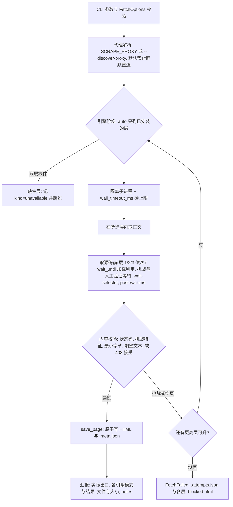

# 稳健浏览器采集

仅采集用户有权访问的公开或获授权页面。遵守目标服务条款、robots/速率限制和适用法律；不要自动执行登录、下单、账户创建、凭据测试或其他改变外部状态的操作。Cloudflare 通过与否受出口 IP、指纹、地区一致性和站点策略共同影响，不承诺通用通过率。

## 入口与读取顺序

先按任务选定入口，再按该行读取依赖文档。

| 任务 | 入口 | 该读 |
| --- | --- | --- |
| 抓单个页面、诊断未知站点 | CLI `scripts/resilient_fetch.py`（默认 `--engine auto`） | 本文件"工作流"与"引擎分层与选择" |
| 只要标题/状态码/字节数，或供其他语言调用 | `scripts/example_extract_page_info.py`（stdout JSON） | 本文件"示例脚本" |
| 页面多于一个、需要预热/复用会话/sitemap | 三条批量会话按依赖选 | [references/batch-workflows.md](references/batch-workflows.md) |
| 在 Python 进程内取页或存盘 | `resilient_fetch` 的 `FetchOptions`/`fetch_page`/`save_page` | [references/module-api.md](references/module-api.md) |
| 安装到 Agent、换机器或换系统 | [references/installation.md](references/installation.md) | 该文件，再读 [references/platforms.md](references/platforms.md) |
| 修改 `scripts/` 或 `tests/` | 直接改脚本，无封装入口 | 本文件"工作流"末段的质量门禁 |

## 工作流

前置：先确认已走 `network-access` 双路探测排除选路问题；普通超时/直连失败不直接启动浏览器，仅当探测显示网络可达但正文为挑战/拦截特征时才用本 skill，选路结论同一任务内复用。

1. 如果需要将本 Skill 安装到 Codex、Claude Code、Cursor 或 Gemini CLI，先读取 [references/installation.md](references/installation.md)。依赖按引擎分层安装，**只装当前任务需要的层**：层 0（`static`）零第三方依赖，层 1 装 `playwright`+浏览器，层 2 装 `requirements-stealth.txt` 并运行 `scrapling install`，层 3 再装 `requirements-cloak.txt` 并运行 `python -m cloakbrowser install`。随后根据当前系统读取 [references/platforms.md](references/platforms.md)，选定独立 Python 3.10+ 环境；国内安装先配置下载路线，`scrapling install` 的系统依赖步骤与页面代理分开处理。环境可以由 Conda、`venv` 或 `uv venv` 管理；Linux 是默认部署目标。先运行 `uv --version`；可用时优先执行 `uv pip install --python <目标环境解释器> ...`，不可用时回退到该环境的 `python -m pip`，不要混用两个安装器修改同一环境。
2. 运行只读环境诊断：

   ```bash
   python <skill-dir>/scripts/check_environment.py --proxy 'http://127.0.0.1:<port>'
   ```

   诊断只反映**运行它的那个解释器**。全局默认 `python` 往往只装了层 0/1，而层 2/3 装在某个 Conda/venv 里；需要某层却报缺件时，先扫一遍本机候选环境，再按建议换解释器运行：

   ```bash
   python <skill-dir>/scripts/check_environment.py --list-envs --require-stealth   # 缺层则退出码 1
   ```

   输出按可运行层数排序，标明每个解释器的管理方式（`conda:<env>`/`venv`/`system`）、可用引擎与缺项，并给出可直接复制运行的命令（含 `conda run -n <env> --no-capture-output python -X utf8 ...` 形式）。`conda run` 必须带 `--no-capture-output`，否则在 GBK 控制台上会被 conda 的捕获重印弄崩。选定环境后用该解释器运行后续所有脚本。

   明确需要本地代理但未设置 `SCRAPE_PROXY` 时，可在抓取命令中添加 `--discover-proxy`，按本机登记文件中的候选依次探测。端口开放只代表存在候选服务，仍需用目标请求验证协议与出口。

3. 先使用 `auto`。它只把**已安装**的引擎列入顺序，按能力从低到高尝试：`static` → `playwright` → `scrapling` → `cloak-cdp`；缺件的引擎记录为 `unavailable` 并跳过，不算失败。每个引擎都在隔离子进程里跑并带硬超时，被内容校验判为挑战页时再升档。静态页在层 0 就能拿到，不必启动浏览器。有引擎因缺件被跳过时，日志会提示"依赖可能装在别的 Python 环境"并指向 `--list-envs`；全部引擎都缺件时，错误信息同样给出这条排查路径。

   ```bash
   python <skill-dir>/scripts/resilient_fetch.py \
     --url 'https://example.com/product' --out './product.html' \
     --proxy 'http://127.0.0.1:<port>' --timeout-ms 300000 \
     --expect-text 'Product name'
   ```

4. 高对抗站点在无头失败后，使用 `--headful --humanize` 重试；Linux 服务器先配置 Xvfb。**层 1（playwright）现在也支持有头人工验证**：配合 `--challenge-wait-ms 300000`，脚本会打开可见窗口并在预算内轮询页面，等你手动过完验证再继续（此前层 1 会直接保存挑战页）。有头模式会先打印操作指引；无头模式若撞上挑战，日志会提示改用 `--headful` 或层 2/3。代理地区未知时不要硬编码语言和时区；已知地区时同时设置 `--locale` 与 `--timezone`，或安装 `cloakbrowser[geoip]` 后使用 `--geoip`。
5. 自动求解返回后仍停在挑战页时，使用 `--challenge-wait-ms 300000 --profile-dir <专用目录>`。有头模式允许用户在这段时间人工完成一次验证，后续运行复用 cookie/localStorage。脚本在该根目录下分别使用 `scrapling/` 与 `cloak/`，避免两种浏览器共享同一 profile。
6. 默认使用状态码、挑战特征、正文大小和最终 origin 做宽松检查。只有用户要求严格验证或目标已知会返回软错误页时，才增加 `--wait-selector`、`--expect-text`、固定路径或业务字段断言；不要把易变商品文案默认写成成功条件。状态码本身不足以判定拦截：HTTP 403 且正文没有拦截特征、长度达标、期望文本全部命中时，按可用内容接受并在 `notes` 记 `http_status:403:accepted_by_content`（日志会告警）；这类正文可能尚未水合，需要完整客户端渲染时显式指定 `--engine scrapling` 等更高层。其余 4xx/5xx 仍按失败处理。
7. 检查 `<输出>.meta.json` 的最终 URL、状态码、引擎、耗时、版本、哈希、`notes` 和尝试记录；失败时按 `<输出>.attempts.json` 里的 `kind` 处置：

   | `kind` 或现象 | 含义 | 下一步 |
   | --- | --- | --- |
   | `unavailable` | 该层依赖不在当前解释器里 | 用 `check_environment.py --list-envs` 换解释器，或按 installation.md 补装该层 |
   | `blocked` / `blocked_or_empty` | 被挑战拦截，或只拿到空壳 | 升档（如 `--engine scrapling`）、换出口，或 `--headful --challenge-wait-ms 300000` 人工过验证 |
   | `runtime_error` | 运行期异常（浏览器缺失、崩溃等） | 看该引擎报错，按 installation.md 补齐缺件后重跑 |
   | 达到 `--wall-timeout-ms` 仍无结论 | 硬上限用尽 | 提高 `--timeout-ms` 与 `--wall-timeout-ms`（如 300000/600000），或先排除出口问题 |
   | `<输出>.<引擎>.blocked.html` | 被拒收的正文 | 与预期文本和结构比对，判断是拦截页还是校验条件过严 |

   汇报结果时用表格汇总：本次实际出口（直连，还是哪个代理/登记名；必要时用外部 IP 检测页核对）、每个引擎的模式与结果（引擎、有无头、状态码、耗时）、最终文件与大小、以及 `notes` 里的软状态码等注记；不要只报模式与引擎名。

修改 Python 脚本后，使用相同的安装器安装 `requirements-dev.txt`，并在技能目录运行以下质量门禁；三条命令必须全部以退出码 `0` 完成：

```bash
python -m ruff check scripts tests
python -m pyright
python -m pytest
```

## 示例脚本

保存网页渲染后源码及 `.meta.json`：

```bash
python <skill-dir>/scripts/example_save_page.py 'https://example.com/' \
  --out './example.html' --discover-proxy --expect-text 'Example Domain'
```

获取网页并以 JSON 打印标题、状态码、最终 URL、引擎、字节数和正文预览：

```bash
python <skill-dir>/scripts/example_extract_page_info.py 'https://example.com/' \
  --discover-proxy --preview-chars 500
```

任意语言可把信息示例作为子进程执行并只解析 stdout 的 JSON；抓取日志写入 stderr。Python 程序也可将 `<skill-dir>/scripts` 加入模块搜索路径，再从 `example_extract_page_info.py` 导入 `fetch_page_info()` 直接取得字典。

需要首次人工验证并连续访问多个页面时，运行有界面批量示例。它只预热一次首页，然后在同一 Scrapling context 中以最多两个 tab 抓取三个商品页：

```bash
python <skill-dir>/scripts/example_greentradingxxl_batch.py \
  --proxy 'http://127.0.0.1:<port>' \
  --output-dir './greentradingxxl-pages'
```

首次出现验证时直接在已打开的浏览器窗口中完成；不要关闭窗口或另开浏览器。该命令使用全新临时 profile 并在关闭后清理。跨重启复用时才添加 `--profile-dir './profiles/greentradingxxl'`；用户明确要求严格业务检查时添加 `--strict`。

## Python 模块调用

外部 Python 程序应优先读取 [references/module-api.md](references/module-api.md)。独立页面从 `resilient_fetch` 导入 `FetchOptions`、`fetch_page()` 或 `save_page()`；静态批量从 `static_session` 导入 `StaticBatchSession`、`StaticSessionOptions`（层 0，零依赖）；需渲染但无求解器的批量从 `browser_session` 导入 `BrowserBatchSession`、`BrowserSessionOptions`（层 1，只要 playwright/patchright）；需要渲染或挑战求解的连续批量从 `site_session` 导入 `SiteSessionManager`、`SiteSessionOptions` 和 `SiteRequest`。调用者应处理结构化异常，不要解析日志文本或模拟 CLI 参数。

模块导入无副作用，也不会调用 `logging.basicConfig()`。`fetch_page()` 仍是每次调用隔离浏览器的单页 API；连续批量任务不得直接并发调用它创建大量浏览器，应使用下面的会话预热模式。

## 批量、并发与 Sitemap

目标页面多于一个或需要访问 sitemap 时，必须读取 [references/batch-workflows.md](references/batch-workflows.md)，并按依赖分层选会话：静态正文用 `static_session.StaticBatchSession`（层 0，零依赖）；需要渲染但不需要挑战求解、或本机只有层 1 时用 `browser_session.BrowserBatchSession`（单 browser/context 多 tab，只要 playwright/patchright）；需要挑战求解用 `site_session.SiteSessionManager`。三者都先在一个会话中单路访问站点首页，完成验证并确认正常内容后，再放开多 tab 并发；前两者命中挑战页即抛 `PageRejectedError` 供升档。访问 sitemap 时使用“首页预热 → sitemap index/子 sitemap → 详情页”的顺序，不要让 sitemap 成为新会话的首个验证页面。

连续批量任务优先复用同一运行中的窗口、context 和临时 profile；多个 tab 对应受限并发，任务结束后再关闭整个浏览器。预热后的子页面先轻量导航并验证内容，检测到新挑战时才暂停队列、重新预热并启用求解重试。不要为每个 URL 或 worker 反复创建、销毁浏览器。仅在跨进程、跨重启或需要保留人工验证成果时使用 `--profile-dir`；profile 可能积累缓存、Service Worker、IndexedDB 和 cookie，占用较多磁盘，且不得由多个进程同时打开。不传 `--profile-dir` 的临时 profile 正常退出会自行清理，异常终止则残留在系统临时目录，识别与清理见 references/platforms.md 的临时 profile 与磁盘残留一节。

## 引擎分层与选择

| 层 | engine | 能力 | 依赖 | 不做什么 |
| --- | --- | --- | --- | --- |
| 0 | `static` | 直连 HTTP 取正文、状态码、重定向链 | 无（stdlib）；socks 代理与 TLS 伪装需 `curl_cffi` | 不执行 JS，不求解挑战 |
| 1 | `playwright` | 无头/有头渲染、等待与交互 | `playwright` 或 `patchright` + 浏览器二进制 | 不求解挑战，指纹弱于层 2 |
| 2 | `scrapling` | 反检测渲染 + Cloudflare/Turnstile 求解 | `requirements-stealth.txt` + `scrapling install` | — |
| 3 | `cloak-cdp` | 层 2 的指纹底座变体 | 层 2 + `requirements-cloak.txt` + `python -m cloakbrowser install` | CloakBrowser 本身不是 CAPTCHA 求解器 |

- `auto`：默认。按上表从低到高、只对已安装的引擎升档；缺件引擎记 `skipped(unavailable)`，不会让整次抓取失败。指定 `--engine <层>` 时缺件直接失败，便于排障。
- 先信任低层：静态页在层 0 就是毫秒级，不要为了"稳"直接开层 2。命中挑战特征或空页才升档。
- 层 0 对客户端渲染站可能只拿到 JS 空壳（正文由脚本注入），默认宽松校验不会拦它。已知目标是 SPA/客户端渲染时，直接指定 `--engine playwright`，或给层 0 加 `--expect-text`/`--wait-selector` 让空壳被判失败后自动升档。
- `scrapling`：挑战求解主力，使用 `StealthyFetcher.fetch(..., solve_cloudflare=True)`，负责识别、点击、等待与内容返回。
- `cloak-cdp`：由 CloakBrowser 启动带代理的 Chromium，再把本机 `ws://` CDP 地址交给 `StealthyFetcher.async_fetch`；它需要层 2 的依赖，不是层 2 的替代品。
- `scrapling-cli`：只用于复现安装、PATH 或参数差异，不参与 `auto`，也不适合作为默认生产入口。

`--headful` 对层 1/2/3 都可用（弹出真实窗口，供首次人工验证）；层 0 不接受 `--headful`。`--humanize`、`--geoip`、`--hide-canvas` 只对层 2/3 生效，层 0 会告警忽略。

有头人工验证（层 1 与层 2/3 都适用）：`--headful --challenge-wait-ms 300000` 会打开可见窗口，在预算内每秒检查一次页面，挑战标记消失即继续（层 1 在验证通过后才执行 `--wait-selector`/截图/取源码，因此选择器不会先在挑战页上超时）。运行时会打印操作指引与进度（首次即提示，之后每 15 秒一条"仍在等待验证"），预算用尽则按当前页面继续并在日志里说明。`--challenge-wait-ms 0` 时不会等待，有头模式会提示建议设为 300000。

默认挑战操作超时为 300000 ms。不要把它降到 60000 ms 以下；验证可能经历多轮跳转。日志中的 `Cloudflare page didn't disappear after 10s` 和 `captcha is still present, solving again` 表示 Scrapling 正在同一页面继续求解，不是终态失败；`No Cloudflare challenge found` 表示页面本来就是正常内容，也不是失败。不要据此中止进程。仅在返回内容仍为挑战页、引擎抛错或达到 `--wall-timeout-ms` 后判失败。需要给内部求解更多轮次时提高硬超时，例如 `--timeout-ms 300000 --wall-timeout-ms 600000`。`--retries` 只控制导航或代理错误重试，与 Cloudflare 内部求解轮次无关。

不要默认启用 `--network-idle`，因为分析、广告和长连接会使它永远不空闲。不要在挑战阶段禁用图片、样式或其他资源。仅当目标明确需要系统 Chrome 时使用 `--real-chrome`；否则使用该层自己安装的浏览器。不要让多个进程并发使用同一 `--profile-dir`（脚本按层分子目录 `playwright/`、`scrapling/`、`cloak/`）。

页面"加载完成"的判定决定取源码与关闭窗口的时机，用 `--wait-until` 显式指定（层 1/2/3；层 0 无浏览器，会告警忽略）。有头人工验证、`--wait-selector`、`--post-wait-ms` 都在取源码之前依次执行。

| 选项 | 判定条件 | 适用与注意 |
| --- | --- | --- |
| `--wait-until commit` | 收到响应即取 | 只要服务端首屏字节；层 2/3 近似为不等页面脚本执行 |
| `--wait-until domcontentloaded` | DOM 解析完成 | 最快拿到 SSR 正文；WAF 站点更容易抓到挑战中间页 |
| `--wait-until load` | load 事件（默认，含图片等子资源） | 与历史行为一致 |
| `--wait-until networkidle` | 网络空闲（约 500ms 无连接） | 长连接/轮询页可能永不空闲；`--network-idle` 是同一等待的遗留写法 |
| `--wait-selector <sel>` | 等到该选择器可见 | SPA 指定内容出现的最可靠判据，可与任一等待条件叠加 |
| `--post-wait-ms <ms>` | 取源码前再静置 | 兜底给客户端渲染留时间（默认 1000） |

等待条件越早，越容易在 WAF 站点上抓到挑战中间页；那会被挑战特征识别并升档，不是误判。层 2/3 的加载与关闭由 Scrapling 管理，`commit`/`domcontentloaded` 映射为它的 `load_dom=False`。

## 单次抓取的处理流程

CLI 与 `fetch_page()`/`save_page()` 走同一条流水线；下图是它对调用者可见的行为，模块视角的组件与数据流见 [references/module-api.md](references/module-api.md)。



- 升档只在内容校验不通过时发生；缺件记 `unavailable` 并跳过，不算失败。整条流程的硬上限是 `--wall-timeout-ms`，与单层自己的 `--timeout-ms` 不同。
- 校验是唯一闸门：状态码、挑战特征、最小字节、调用方期望文本都在这里判定，`--wait-until`、`--wait-selector`、`--post-wait-ms` 只改变取源码的时机。
- 落盘只发生在 `save_page()`（CLI 默认开启）：成功写 HTML 与 `.meta.json`，失败写 `.attempts.json` 与 `<输出>.<引擎>.blocked.html`；`fetch_page()` 只返回内存结果。

## 代理与凭据

使用 `SCRAPE_PROXY` 可避免重复输入代理。需要代理解析本机入口时，先读本机登记文件再用 `--discover-proxy` 探测登记中的候选。脚本只预检代理端口；端口可连通不代表协议、出口 IP、ASN、DNS 和地区正确，必要时通过代理访问外部 IP 检测页再核对。默认代理不可达或发现失败时退出码为 `2`，不会静默直连；只有用户明确接受本机出口时才添加 `--allow-direct`。

不要把带用户名和密码的代理 URL 写入源码、持久日志或元数据。脚本日志会遮蔽代理凭据，但操作系统进程列表仍可能看到用户传入的命令行参数；敏感凭据优先放入当前进程的 `SCRAPE_PROXY` 环境变量。

单页验证或故障定位直接使用本技能脚本；批量任务遵循上面的预热屏障和会话复用要求。
