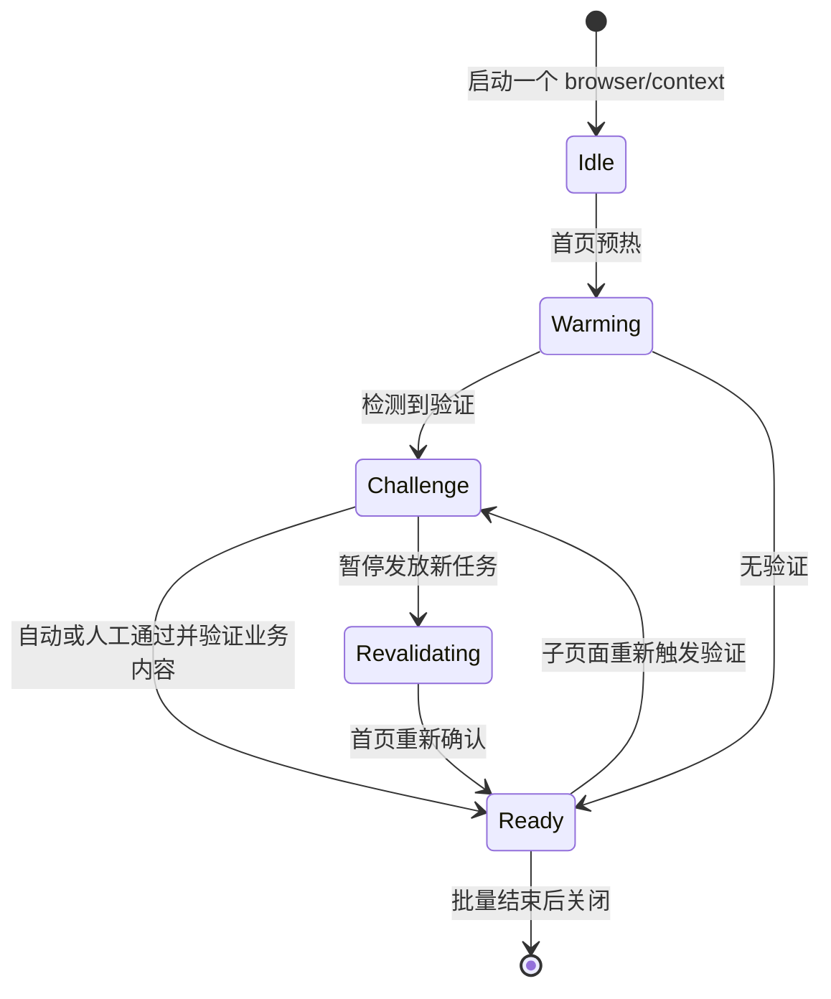

# 批量、并发与 Sitemap

> 适用范围：本文件第 1 节的三条会话路径按依赖分层选择——层 0 静态页用 `static_session.StaticBatchSession`（受限并发 HTTP，零依赖）；需要渲染但不需要挑战求解、或本机只有层 1 时用 `browser_session.BrowserBatchSession`（单 browser/context 多 tab，只要 playwright/patchright）；需要挑战求解的诊断/会话用 `site_session.SiteSessionManager`（层 2+，带 challenge 监视与重验证屏障）。三者的预热、同源与验证语义一致，命中挑战都抛 `PageRejectedError`（`SiteSessionManager` 例外：它会暂停并发并重验证），由调用方决定升档。层 2/3 的控制面仍是 Patchright；目标专门卡驱动时，批量会话不会因换到 CloakBrowser 而改变控制面。

## 选哪条会话路径

| 条件 | 路径 | 依赖 |
| --- | --- | --- |
| 页面静态可取（层 0 就够） | `StaticBatchSession` | 无 |
| 页面需渲染，且本机只有 playwright/patchright | `BrowserBatchSession` | 层 1（可用 `playwright_api` 固定驱动） |
| 页面有挑战/指纹拦截，或需要人工验证 + 求解接力 | `SiteSessionManager` | 层 2（+ 层 3 可选） |
| 怀疑 Patchright 控制面被识别，想试直接 CDP | 不套批量会话：单页 `--engine nodriver --headful` | 可选 nodriver + 系统 Chrome |

先按"首页是否能在层 0 拿到正文"判定：`static_session` 预热失败或正文过短（SPA 空壳）时改 `browser_session`；`browser_session` 预热/子页抛 `PageRejectedError` 且 `result.block_reasons` 非空时才是挑战页，这时才升到层 2。

## 必须遵循的顺序

1. 按站点 origin、代理出口和浏览器身份对 URL 分组。
2. 只创建一个浏览器会话，先单路访问站点首页。默认使用状态码、挑战特征、正文大小和最终 origin 做基础确认；只有用户要求严格检查时才增加固定标题、选择器、业务文本或路径断言。
3. 设置一个预热屏障：只有首页验证成功后，才创建其他 tab 或启动并发任务。预热失败时不要放开并发。
4. 请求 sitemap 时，按“首页 → sitemap index → 子 sitemap → 详情页”的顺序执行。不要把 `/sitemap.xml` 作为新会话的首个验证页面。
5. 后续请求继续使用相同 browser/context、代理、locale、timezone 和 User-Agent（需要时由 `useragent`/`referer` 选项统一指定，会话内不要中途更换身份）。`SiteSessionManager` 先执行不带求解等待的轻量子页面导航；若返回内容出现挑战特征，再暂停新任务、重新预热并以 `solve_cloudflare=True` 重试该页。
6. 任务完成后再关闭整个会话，不要为每个 URL 创建并销毁浏览器。并发数应小于等于 `max_pages`，并按站点容量设置较小上限。

### 探针与对照页

同一站点的主目标、对照页、公开接口端点（如 `.json`/`.rss`）和状态探针也属于多 URL 任务，合并进一个已预热会话即可，不要为每个探针启动新浏览器：

1. 先单路访问首页完成预热，确认出口和会话可用。
2. 按“主目标 → 对照页 → 接口端点”的顺序在同一 context 中导航；每次导航后做轻量内容验证，不要只看状态码。
3. 遇到 404/410 先按资源级结论处理（删帖、私密、ID 错误或未发布），不要换引擎重复请求；需要区分“站点说不可见”和“管道坏了”时，用同站对照页的一次 200 响应证明。
4. 论坛、列表、评论区类目标的首屏不是全量：用站点自身的计数或分页端点确定总量（例：Discourse `/t/<id>.json` 给 `posts_count` 与完整 `post_stream.stream`，`?page=N` 取后续页），再决定是否取全量；渲染后的节点数只能说明已渲染部分没有丢，不能当覆盖度。
5. 只有对照页或端点也命中挑战时，才暂停队列、重新预热并切到求解路径；单个 404/410 不触发升档。

Cloudflare cookie 可能与域名、出口 IP 和浏览器指纹绑定。跨 origin 或跨子域不保证共享验证成果；必要时为每个需要独立验证的 origin 分别预热。

## 层 1 浏览器会话（无求解器也能批量渲染）

只有 playwright/patchright 时，用 `browser_session.BrowserBatchSession`：一个 browser、一个 context、每页一个 tab，按 `concurrency` 受限并发。它不装也不依赖 scrapling，因此主要面向"JS 渲染得到正文、但没有挑战"的批量任务；DOM 可用，所以 `expected_selector`/`wait_selector` 都能校验（`StaticBatchSession` 只能用 `expected_texts`）。

```python
from browser_session import BrowserBatchSession, BrowserSessionOptions
from site_session import SiteRequest


async def fetch_rendered(home_url: str, urls: list[str], proxy: str) -> list[str]:
    options = BrowserSessionOptions(
        home_url=home_url,
        proxy=proxy,
        headless=True,
        max_pages=6,
        concurrency=2,
        timeout_ms=60_000,
        wall_timeout_ms=90_000,
        post_wait_ms=1_500,          # 给客户端渲染留时间
        playwright_api="auto",       # auto | playwright | patchright
        expected_home_texts=("已知业务关键词",),
    )
    async with BrowserBatchSession(options) as site:
        await site.warmup()
        results = await site.fetch_many([SiteRequest(url) for url in urls])
        return [result.html for result in results]
```

- 挑战页不求解：命中时抛 `PageRejectedError` 并把 `block_reasons` 带在结果里，据此决定升到层 2 或改用人工验证。
- `playwright_api` 只控制本会话的层 1；装层 2 会带入 Patchright，做驱动 A/B 时显式指定。结果 `notes` 会记录 `control_plane`、`browser_channel`、`headless`。
- 人工验证：`headless=False` + `challenge_wait_ms=300000` 时，每页在预算内等验证标记消失再取源码（无头模式下该参数会被拒绝，因为没有人工可介入）。批量下建议只在首页预热阶段开有头。
- 想复用登录/验证态跨进程时给 `profile_dir`（目录由调用方管理，不会被自动删除）；不给自己用一次性 context。
- 截图（排查用）设 `screenshot_dir`，文件名由 `request_slug()` 从 URL 生成。

## Scrapling 会话模式

使用 `site_session.SiteSessionManager` 维持一个 `AsyncStealthySession`、一个浏览器上下文和受限数量的 tab。管理器提供 single-flight 预热、同源检查、挑战页检测、结构化内容验证、五分钟硬超时和重验证屏障。该路径的控制面仍是 Scrapling 内部的 Patchright；如果层 2 和层 3 都以同一挑战签名失败，先按 [检测层与引擎选择](detection-layers.md) 判断控制面/出口，而不是继续给批量会话加 tab。



下面的 Python API 不写文件，返回顺序与输入顺序一致：

```python
from site_session import SiteRequest, SiteSessionManager, SiteSessionOptions


async def fetch_batch(home_url: str, urls: list[str], proxy: str) -> list[str]:
    options = SiteSessionOptions(
        home_url=home_url,
        proxy=proxy,
        headless=False,
        max_pages=4,
        concurrency=3,
        timeout_ms=300_000,
        wall_timeout_ms=330_000,
    )
    async with SiteSessionManager(options) as site:
        await site.warmup()
        results = await site.fetch_many([SiteRequest(url) for url in urls])
        return [result.html for result in results]
```

`SiteSessionManager.fetch()` 和 `fetch_many()` 会自动确保预热，但生产调用应显式调用 `warmup()`，让失败发生在创建批量任务之前。访问 sitemap 时先完成 `await site.warmup()`，再请求 sitemap；解析得到详情 URL 后才启动受限并发。

管理器只允许与 `home_url` 同源的 URL，防止把同一浏览器身份和会话状态意外带到其他站点。跨 origin 或需要不同代理时创建独立管理器。

## 人工首次验证

设置 `headless=False` 后，Scrapling 的自动求解与可见窗口同时工作。检测到挑战时，管理器清除就绪事件并通过 `on_challenge(ChallengeEvent)` 通知调用者；用户在这个窗口中完成验证，Scrapling 返回业务页面后才开放并发。不要调用 `input()` 阻塞事件循环，也不要等待用户手动声明完成；以页面状态和业务字段为准。

不要先在 CloakBrowser 默认 context 中人工验证，再假定 `AsyncStealthySession(cdp_url=...)` 会复用它。Scrapling 0.4.11 的 CDP 会话会创建新的 context。必须精确保留 CloakBrowser context 时，继续用该 Playwright context 导航，只把 `page.content()` 交给 Scrapling `Selector` 解析。

`SiteSessionManager` 在同一运行内复用浏览器最完整的活动状态。`storage_state` 或 cookie 导出只适合辅助恢复，不等价于原 context，不能保证 Cloudflare clearance 继续有效。

## Profile 选择

- 全新试验或连续单次批量：不设置 `profile_dir`。管理器显式创建空的临时 profile，多个 tab 共用该 context，关闭浏览器后清理目录。
- 跨进程、跨重启或需要保留人工验证：使用专用 `--profile-dir`。不要让多个进程同时打开同一目录。
- 磁盘管理：profile 会积累缓存、Service Worker、IndexedDB、Local Storage 和 cookie，可能明显增长。记录目录位置和大小；只在浏览器完全关闭且确认不再需要会话成果后清理。
- 多 worker：不要把“每个 worker 一个新浏览器”当作 tab 并发。它会重复验证、增加内存和磁盘开销，并可能因短时间产生多个新身份而提高拦截概率。

## GreenTradingXXL 示例

运行 `scripts/example_greentradingxxl_batch.py`。脚本先访问首页，允许在可见窗口完成人工验证，然后复用同一 context 抓取三个指定商品页，将渲染后 HTML 和 `summary.json` 写入输出目录。默认使用全新临时 profile 和宽松检查；只有明确需要业务断言时添加 `--strict`。默认按本机登记文件中的候选探测本地代理，代理不可用时不会静默直连。
