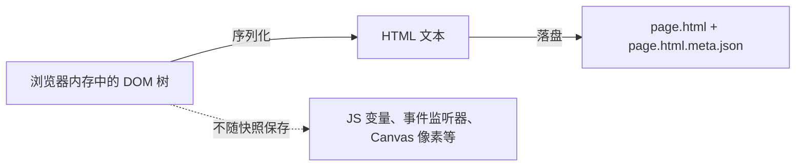

# HTML 快照与序列化

本文解释本 skill 里的“HTML 快照”是什么、序列化做了什么，以及它与原始 HTML、离线存档、截图的区别。需要判断交付物或阅读 `.meta.json` 时读本文；具体命令与选项以脚本的 `--help full` 为准（`--help` 给一屏看完的短版）。

## 一句话定义

HTML 快照通常指浏览器把**当前渲染后的 DOM** 序列化为 HTML 文本，由 `save_page` 写入 `.html`，并附一份 `.meta.json`。它包含取快照时已经出现的 JS 渲染内容，但不把图片、样式、字体或外部脚本保存到本地。

层 0 `static` 没有浏览器，`save_page` 保存的是 HTTP 响应正文，不执行 JS；需要 JS 注入内容时必须使用浏览器层。

## 序列化不是“写到硬盘”

- **序列化**：把内存中的对象或数据结构转换成一种可存储、可传输的格式，例如 HTML 文本、JSON、字节流。
- **落盘 / 持久化**：把序列化后的结果写入文件或数据库。

在本 skill 中，过程是：



序列化只完成“DOM 树 → HTML 文本”的转换；`save_page` 再把文本写入磁盘。元数据也是先序列化为 JSON，再写入 `.meta.json`。硬盘上保存的是文本和字节，不是原来的 DOM 对象或浏览器运行时。

## 快照包含什么

- 当前 DOM 的标记、文本和属性，包括取快照前已经由 JS 注入的内容。
- 内联样式和脚本，以及仍然指向原站的外部样式表、外部脚本、图片和字体 URL。
- 最终 URL、状态码、引擎、耗时、哈希和注记等元数据，写入同名 `.meta.json`。
- 浏览器在取源码时的页面状态；之后页面再变化不会自动更新快照。

## 快照不包含什么

- JS 变量、事件监听器、定时器和其他运行时状态。
- Canvas、WebGL 绘制的像素；它们的文字不会变成 HTML 文本。
- 打开的 Shadow DOM 树通常不会进入普通 HTML 序列化结果；正文若在 Shadow DOM 中，需要额外取法。
- iframe 的内容文档；父页面 HTML 只保留 `<iframe>` 元素本身。
- 表单的当前输入值、勾选状态、滚动位置、展开状态等不一定保留；序列化通常读取 DOM 属性，而不是用户操作后的实时属性。
- 图片、CSS、字体和外部脚本文件本身；它们只保留 URL。

因此，快照是一个**时刻**的 DOM 文本。懒加载、无限滚动或点击后才出现的商品描述，必须先在取源码前触发；CLI 的等待参数不会自动滚动或点击。

## 与相邻概念的区别

| 名称 | 产物 | JS 渲染内容 | 图片等资源 | 离线打开 | 典型用途 |
| --- | --- | --- | --- | --- | --- |
| 原始 HTML 源码 | 服务器返回的 HTML | 通常没有，可能只是空壳 | 保留原始引用，可能是相对路径 | 可能缺内容 | 查看服务端原始结构、排查 |
| HTML 快照 | 渲染后的 DOM 写成 `.html` + `.meta.json` | 有，截止取快照时 | 只保留远程 URL，不落盘 | 文字和结构可看，图片/样式可能缺 | 保存页面内容、后续分析 |
| 离线存档 / MHTML | HTML 加下载或内联的资源 | 有 | 下载到本地或转成 data URI | 通常可离线看 | 归档、断网阅读 |
| 网页截图 | PNG/JPG | 只能看，不能提取结构 | 不涉及 | 是图片 | 视觉证据、版式记录 |
| 搜索引擎快照 | 搜索引擎缓存的副本 | 取决于服务 | 取决于服务 | 取决于服务 | 快速查看历史版本 |

表中“JS 渲染内容”指浏览器层；层 0 `static` 的 `save_page` 保存 HTTP 响应正文，不做 JS 渲染。

“网页快照”一词在不同语境下可能指截图、搜索引擎缓存或离线存档；本 skill 统一用“HTML 快照”指代上表中的第二种产物，避免歧义。

## 文件形态与判定

```text
page.html                 # 渲染后的 DOM 文本
page.html.meta.json       # 最终 URL、状态码、引擎、耗时、哈希、notes 等
```

- 只有 `.html` 和 `.meta.json`：通常是 HTML 快照。
- 出现资源目录（如 `page.archive_files/`）、MHTML，或大量 `data:` URI：是离线存档，不是纯 HTML 快照。
- 只有 `.png` / `.jpg`：是截图，不含可提取的 DOM 文本。

`save_page` 失败时还会写 `.attempts.json` 和拦截诊断页；这些是诊断产物，不是成功快照。

## 选择建议

- 要保存页面内容、商品描述等正文，图片保留原链接：用 HTML 快照。
- 要断网打开、连图片和样式一起归档：用离线存档或 MHTML。
- 只要视觉证据：用截图。
- 只要产品字段、价格、规格等结构化数据：取回页面后提取，不要求保存 HTML；字段来自接口时读接口 JSON。

HTML 快照离线打开时，文字和 DOM 结构通常还在，但图片、外部样式和脚本可能加载失败；如果外部脚本重新执行并改写页面，显示结果也可能变化。需要固定的视觉结果时，用截图或离线存档，不要只依赖 HTML 快照。
