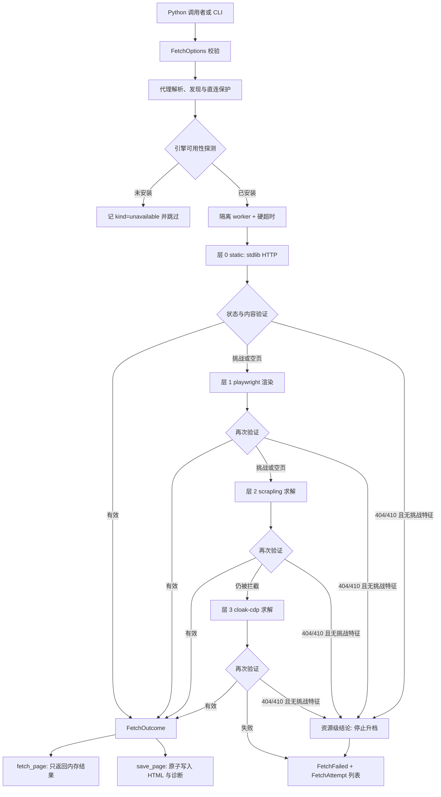

# Python 模块设计与 API

将 `<skill-dir>/scripts` 加入 `PYTHONPATH` 或 `sys.path` 后，按任务类型导入 `resilient_fetch` 或 `site_session`。导入模块不会启动浏览器、修改日志配置或写文件。

可用层由**导入并运行这段代码的解释器**决定（层 2/3 的包必须装在该解释器所在环境里），换环境即可换层，不需要重新安装本 Skill 的代码。调用方若要在渲染/求解环境里运行，请用该环境的解释器启动进程（如 `conda run -n <env> --no-capture-output python -X utf8 <脚本>`），或先 `conda activate`；同机哪些解释器具备哪些层，用 `check_environment.py --list-envs` 查询。

## 模块定位

`resilient_fetch` 不是新的 Cloudflare 求解器。实际挑战识别与交互仍由 Scrapling 完成，CloakBrowser 只提供可选的 Chromium 指纹底座。本模块的意义是把容易遗漏且跨项目重复出现的可靠性措施组合成一个明确契约，并按能力分层调度引擎：层 0 `static`（标准库 HTTP）、层 1 `playwright`（Playwright 或 Patchright）、层 2 `scrapling`、层 3 `cloak-cdp`，另有可选的直接 CDP 引擎 `nodriver`（系统 Chrome，有头后备）。层 0 没有任何第三方依赖。层号是能力档位，不代表隐蔽性；控制面/指纹/IP 的矩阵见 [检测层与引擎选择](detection-layers.md)。

| 能力 | 直接调用 Scrapling | `resilient_fetch` |
| --- | --- | --- |
| Cloudflare 求解算法 | Scrapling 原生实现 | 仍使用 Scrapling，不声称更强 |
| 浏览器生命周期 | 调用者管理 | 每个引擎在隔离子进程中运行，并有硬超时和进程树回收 |
| 引擎可用性 | 调用者自行判断 | 注册表 + 进程内探测；`auto` 只升档到已安装的引擎 |
| 失败回退 | 调用者编排 | `static → playwright → scrapling → cloak-cdp` 按层升档；`nodriver` 仅在显式选择或 `--headful` 的 `auto` 中作为最后后备 |
| 代理安全 | 调用者处理 | 代理预检、本地端口发现、默认禁止静默直连、凭据遮蔽 |
| 成功判断 | 通常由调用者判断 | 同时检查 HTTP 状态、挑战特征、最小字节数和业务文本 |
| 结果模型 | Scrapling `Response` | 统一为 `FetchResult`、`FetchAttempt`（含 `kind` 失败分类）和 `FetchOutcome` |
| 文件输出 | 调用者实现 | 可选原子写入、SHA-256、元数据、失败 HTML 和尝试记录 |
| 批量共享会话 | 调用者自行实现状态协调 | `site_session` 提供预热、人工接管通知、就绪屏障、同源限制和重验证（当前仅层 2） |

因此，`resilient_fetch` 适合一次性页面任务、作业队列中的独立任务、未知站点诊断和需要可预测失败边界的服务。连续批量、首页预热、人工首次验证和多 tab 复用使用 `site_session`。需要自定义复杂 `page_action` 或直接操作 Playwright `Page` 时才绕过管理器调用 Scrapling 原生 session。

## 组件与数据流



关键边界：

- 上图未展开可选的 nodriver：它只在显式 `engine="nodriver"`，或 `engine="auto"` 且 `headful=True` 时作为最后后备；不启用 Network 域，`status` 为 `None`。
- `chrome-late` 同样不在自动阶梯里：它在显式 `engine="chrome-late"` 时运行，自行拉起系统浏览器、等站点的挑战跑完后接入读取，回收责任见 SKILL.md 的“资源回收”。`settle_ms`（默认 5000）是最小静默窗口，`render_timeout_ms`（默认 15000）是接入后等渲染稳定的上限。
- `browser_brand`（默认 `None`）指定**系统浏览器品牌**：`auto`（默认，按平台顺序找 Chrome→Edge→Chromium）/`chrome`/`edge`/`chromium`，也可用环境变量 `RESILIENT_BROWSER` 设置。它落到每个引擎的浏览器选择上：`chrome-late` 用它做浏览器发现，层 1 映射成 Playwright 的 `channel`（`msedge`/`chrome`），层 2 与 `nodriver` 用它解析出的可执行文件；`executable_path` 优先级更高（给了路径就用路径）。边缘封禁可能按**客户端品牌**判负（实测同一出口、同一协议、同一 profile 下 Chrome 被拒、Edge 放行），这时换品牌比换出口更对症。`notes` 里的 `browser_channel` 如实写实际客户端（如 `system-edge(msedge.exe)`）。
- worker 隔离防止浏览器启动、挑战循环或关闭阶段拖死调用进程。
- `wall_timeout_ms` 是调用者可预测的硬上限，不等同于 Scrapling 的页面操作超时。
- 回退引擎返回 HTTP `200` 也必须经过内容验证，避免把挑战页当成业务页面。
- 状态码不单独判拦截：403 且正文无拦截特征、长度达标、调用方期望文本命中时按可用内容接受，并在 `result.notes` 记 `http_status:403:accepted_by_content`；其余 4xx/5xx 仍失败。
- `auto` 在 404/410 且正文无挑战特征时停止升档：资源级结论不会因换引擎而改变，调用方应核对 URL、权限或站点可见性。
- `wait_until` 决定取源码与关闭窗口的时机（层 1/2/3 与 nodriver）：`commit` / `domcontentloaded` / `load`(默认) / `networkidle`；层 2/3 把前两者映射为 Scrapling 的 `load_dom=False`，nodriver 通过轮询 `document.readyState` 实现，`networkidle` 会告警并按 `load` 处理。
- `playwright_api` 只控制层 1：`auto` 优先 Patchright，也可显式指定 `playwright` / `patchright`。装层 2 会带入 Patchright，做 A/B 或复现时要固定；层 2/3 内部固定使用 Patchright。浏览器结果的 `notes` 会记录 `control_plane`、`browser_channel`、`headless`；Playwright 系引擎另有 `playwright_api`，用于区分“同层但驱动/渠道不同”。
- `impersonate` 只作用于层 0：非空时改用 curl_cffi 以浏览器同族的 TLS/HTTP2 指纹出网（需安装 curl_cffi，否则构造 `FetchOptions` 即报错），结果里记 `notes: impersonate:<目标>`；浏览器层自带指纹，传了会告警忽略。
- `user_agent` / `referer` 控制身份头：`user_agent` 覆盖各层默认 UA（层 0 只有显式给出时才覆盖 impersonate 目标的 UA，避免 TLS/UA 版本矛盾）；`referer` 为 `None` 时保留各层默认（层 2/3 默认是 Scrapling 带来的 `https://www.google.com/`），空串表示显式不发，非空必须是完整 http(s) URL。含换行的 UA 或非法 URL 在构造 `FetchOptions` 时即报错。
- `solve_akamai`（默认 `False`）打开 Akamai Bot Manager 求解，只在层 1/2/3 与 `chrome-late` 生效，其它引擎会告警忽略。开启时 `timeout_ms` 不得低于 60000（挑战页自身要等满最短时长，之后才轮到本地兜底）。求解流程是“先让挑战页自己跑，跑不过再本地解 SEC-CPT 的 SHA-256 工作量证明并从页面内提交”，不需要外部 API 或密钥；结果写进 `result.notes`：`akamai:solved` / `akamai:unsolved` / `akamai:no_challenge` / `akamai:edge_block`，另有 `akamai_detail:` 与 `akamai_step:` 说明经过的步骤。**它只解挑战页**：Akamai 的边缘封禁（403 `Access Denied` / `Reference #18.…`）没有挑战窗口，求解器无解，只能换出口；behavioral 型挑战要采集行为数据，本 skill 不伪造。
- `cdp_url`（默认 `None`）指定一个**已经开着调试端口的浏览器**，例如 `http://127.0.0.1:9222`。给了它就只走 `cdp-attach` 引擎：接管那个浏览器，读它里已经放行的目标标签页的 DOM，然后断开。**不关闭那个浏览器、不导航它、不碰它的 profile**（`notes` 记 `browser_owned:false`）。浏览器里没有目标页时直接报错并提示先手动打开；`cdp_navigate=True` 才让它去导航（导航期间调试会话在挑战窗口里，可能被 WAF 判负）。`--cdp-url` 与 `--engine <别的引擎>` 冲突会在校验期报错。
- `fetch_page()` 不写业务文件；`save_page()` 才拥有文件副作用。

## 获取页面但不写文件

```python
from resilient_fetch import FetchFailed, FetchOptions, fetch_page

options = FetchOptions(
    url="https://example.com/",
    discover_proxy=True,
    timeout_ms=300_000,
    wall_timeout_ms=600_000,
    wait_until="load",          # commit | domcontentloaded | load | networkidle
    playwright_api="auto",      # 仅层 1：auto | playwright | patchright
    user_agent=None,            # None=各层默认；层 0 显式设置时才覆盖 impersonate 的 UA
    referer=None,               # None=各层默认；""=显式不发(层 2/3 会关掉 Google referer)
    expected_texts=("Example Domain",),
)

try:
    outcome = fetch_page(options)
except FetchFailed as exc:
    for attempt in exc.attempts:
        print(attempt.engine, attempt.error, attempt.reasons)
    raise

print(outcome.result.status)
print(outcome.result.title)
print(outcome.result.html)
print([attempt.as_metadata() for attempt in outcome.attempts])
```

`fetch_page()` 返回 `FetchOutcome`，不会写 HTML、元数据或诊断文件：

- `outcome.result`：`FetchResult`，包含 `html`、`title`、`status`、`final_url`、`engine`、耗时、版本和 `notes`（不影响判定的注记，如按内容接受的 403，以及浏览器引擎的 `control_plane` / `playwright_api` / `browser_channel` / `headless`）。
- `outcome.attempts`：每个被尝试（或被缺件跳过）的引擎的 `FetchAttempt`；被拒绝页面保存在 `rejected_html`，`kind` 给出 `unavailable` / `blocked` / `blocked_or_empty` / `runtime_error` / `ok` 分类。
- `outcome.proxy`：最终使用的代理，可能因显式允许直连而为 `None`。

`FetchFailed` 另外提供 `unavailable_engines`、`blocked_engines` 与 `describe()`，便于调用方区分"该装依赖"和"该换路线"：

```python
except FetchFailed as exc:
    if exc.unavailable_engines and not exc.blocked_engines:
        print("按层安装依赖后再试:", exc.unavailable_engines)
    else:
        print("已尝试引擎被拦截，考虑升档或换出口:", exc.blocked_engines)
    print(exc.describe())
```

## 获取并保存

```python
from resilient_fetch import FetchOptions, save_page

outcome = save_page(
    FetchOptions(url="https://example.com/", proxy="http://127.0.0.1:<port>"),
    "./example.html",
)
```

`save_page()` 复用同一获取 API，并原子写入 HTML、`.meta.json`、失败尝试记录和拦截诊断页。成功时仍返回 `FetchOutcome`。HTML 的序列化边界、与离线存档的区别见 [HTML 快照与序列化](html-snapshot.md)。

## 异常与日志

- `ValueError`：URL、超时、引擎或数值选项无效。
- `ProxyUnavailableError`：显式代理或本地代理发现失败，且未允许直连。
- `FetchFailed`：所有引擎都异常或返回了无效内容；通过 `attempts` 检查结构化原因。

模块不调用 `logging.basicConfig()`。库调用者自行配置日志；只有 CLI 和示例脚本配置默认日志格式。

## 生命周期边界

`fetch_page()` 为单页可靠性使用隔离子进程，并可能按顺序启动 Scrapling、CloakBrowser 或 nodriver。它适合单次调用、作业队列中的独立任务和故障隔离，不适合在连续批量任务中对很多 URL 直接并发调用，否则会创建多个浏览器并重复验证。同一站点的主目标、对照页、接口端点和状态探针也属于连续任务，应复用同一会话，不要为每个探针调用一次 `fetch_page()`。

连续批量或 sitemap 任务按依赖选会话：[batch-workflows.md](batch-workflows.md) 里的 `StaticBatchSession`（层 0 静态页，零依赖）、`BrowserBatchSession`（层 1 渲染，只要 playwright/patchright）或 `SiteSessionManager`（层 2+，带挑战求解与重验证）：先首页预热，再复用同一会话做受限并发。

## 静态批量会话（层 0）

目标页面都是静态正文时，用 `static_session.StaticBatchSession`，不需要浏览器、不需要 scrapling：

```python
from static_session import StaticBatchSession, StaticSessionOptions

options = StaticSessionOptions(
    home_url="https://example.com/",
    proxy="http://127.0.0.1:<port>",
    max_pages=8,
    concurrency=4,
    timeout_ms=30_000,
    wall_timeout_ms=60_000,
    impersonate="chrome124",   # 可选：层 0 的 TLS/HTTP2 伪装，需 curl_cffi
)

async with StaticBatchSession(options) as site:
    await site.warmup()  # 单路验证首页与出口，失败即 WarmupError
    results = await site.fetch_many([f"https://example.com/page/{i}" for i in range(1, 6)])
```

与浏览器会话的差异（有意为之）：

- 不求解挑战、不做重验证：命中挑战特征时抛 `PageRejectedError`，结果里的 `block_reasons` 供调用方决定升档到 `SiteSessionManager` 或 `fetch_page(engine="auto")`；
- 没有 DOM 引擎：`expected_selector` 直接报错，`wait_selector` 忽略并告警，严格检查请用 `expected_texts`；
- 并发受 `concurrency` 信号量约束，每页各自有 `wall_timeout_ms` 硬超时；超时抛 `PageTimeoutError`；
- `timeout_ms` 是单次 HTTP 超时，没有浏览器那套 60000 ms 下限，默认 30 秒；
- `impersonate` 可选，语义与 `FetchOptions.impersonate` 相同：非空时整批都走 curl_cffi 的 TLS/HTTP2 伪装，未安装 curl_cffi 或目标非法会在构造 `StaticSessionOptions` 时直接报错；`user_agent` / `referer` 同样透传给层 0（`referer=""` 表示整批不发 Referer）。

## 层 1 浏览器批量会话

只有 playwright/patchright、没有 scrapling 时，用 `browser_session.BrowserBatchSession`（单 browser/context、每页一个 tab、受限并发、无挑战求解）：

```python
from browser_session import BrowserBatchSession, BrowserSessionOptions
from site_session import SiteRequest

options = BrowserSessionOptions(
    home_url="https://example.com/",
    proxy="http://127.0.0.1:<port>",
    headless=True,
    max_pages=6,
    concurrency=2,
    timeout_ms=60_000,
    wall_timeout_ms=90_000,
    post_wait_ms=1_500,        # 客户端渲染内容出现前的额外等待
    playwright_api="auto",     # auto | playwright | patchright；仅本会话的层 1
    user_agent=None,           # 覆盖浏览器真实 UA(默认无头会带 HeadlessChrome 标记)
    referer=None,              # 设置时作为每页导航的 Referer
)

async with BrowserBatchSession(options) as site:
    await site.warmup()
    results = await site.fetch_many([SiteRequest(f"https://example.com/p/{i}") for i in range(1, 5)])
```

与另外两条会话路径的差异：

- 不求解挑战、不做重验证：命中挑战抛 `PageRejectedError`（结果里带 `block_reasons`），据此升到 `SiteSessionManager` 或改人工验证；
- 有真实 DOM，所以 `expected_selector` / `wait_selector` 可用（层 0 的 `StaticBatchSession` 只能用 `expected_texts`）；`wait_selector` 缺失即抛 `missing_wait_selector:<sel>`；
- `headless=False` + `challenge_wait_ms=300000` 等人工过验证（无头模式下传该参数会直接报错，因为没人能介入）；批量场景建议只在预热阶段开有头；
- `profile_dir` 可选，用于跨进程复用登录/验证态（目录由调用方管理，不自动清理）；不设则用一次性 context；
- `playwright_api` 控制本会话使用 Playwright 还是 Patchright；结果 `notes` 记录实际的 `control_plane`、`browser_channel` 和 `headless`；
- 每页独立 tab、失败重试由 `retries`/`retry_delay` 控制，`wall_timeout_ms` 是单页硬超时（超时抛 `PageTimeoutError`）。

`nodriver` 不提供批量会话封装。它每次调用都会启动/关闭一个系统 Chrome，适合单页控制面备用；不要为批量任务直接并发调用它，也不要把它误当成 `SiteSessionManager` 的层 2 求解器。

## 直接 CDP 单页（nodriver，可选）

只有在明确需要绕开 Patchright 控制面、且接受系统 Chrome 有头模式时才使用 nodriver。它不求解挑战、不伪造指纹，许可为 AGPL-3.0：

```python
from resilient_fetch import FetchOptions, fetch_page

outcome = fetch_page(
    FetchOptions(
        url="https://example.com/",
        engine="nodriver",       # 显式选择；auto 仅在 headful=True 时加入
        headful=True,
        timeout_ms=300_000,
        wall_timeout_ms=600_000,
    )
)
print(outcome.result.notes)      # control_plane:direct-cdp / browser_channel:system-chrome
```

`FetchOptions(engine="nodriver")` 会忽略 `humanize`、`geoip`、`hide_canvas`、`network_idle`、`referer` 并告警；`networkidle` 等待也会退化为 `load`。它不启用 Network 域，所以 `result.status` 为 `None`；需要状态码判定时改用 Playwright/Scrapling，或另做一次有界 HTTP 对照。无头 nodriver 通常明显更弱，不建议作为反检测默认路线。

## 晚接入单页（chrome-late，可选）

适用于"普通浏览器能打开、而前面每个引擎都被拦"的站点：先让站点的挑战流程跑完，再接入调试器读已渲染 DOM。

```python
from resilient_fetch import FetchOptions, fetch_page

outcome = fetch_page(
    FetchOptions(
        url="https://example.com/",
        engine="chrome-late",     # 显式选择；不进 auto
        settle_ms=5_000,          # 最小静默窗口:这段时间不接调试器
        render_timeout_ms=15_000, # 接入后等渲染稳定的上限
        render_min_ms=0,          # 接入后至少等这么久才认渲染完成
        timeout_ms=120_000,
        wall_timeout_ms=240_000,
        expected_texts=("Example Domain",),
    )
)
print(outcome.result.notes)
# control_plane:late-cdp-attach / browser_channel:system-chrome(chrome.exe)
# pre_attach_state:content / final_state:content / attach_delay_ms:21480 / render_wait_ms:8320
```

`notes` 里的四个复盘字段含义：`pre_attach_state` 是接入前页面状态（`content` / `challenge` / `blocked` / `empty`），`final_state` 是读取时的状态（多出 `shell` = 一直没水合的应用壳、`error` = 站点自己报错），`attach_delay_ms` 是从启动浏览器到接入调试器的间隔，`render_wait_ms` 是接入后等渲染稳定的耗时；另有 `render_html_bytes` 与 `render_text_chars` 说明读到的页面有多大、正文有多少字。`challenge` 表示站点还在挑战、没放行；`blocked` 表示已被拒绝（标题 `Access Denied` 一类）。

渲染等待的判据是"稳定"，但**稳定不等于就绪**：客户端渲染的应用常先停在稳定的小壳上，所以引擎在"HTML 很大但可见文字很少"与"站点自己报错"时会继续等；给了 `expected_texts` 时则以期望文本出现为准。`render_min_ms` 可设最短等待，`render_timeout_ms` 是上限。

约束：固定有头运行（Linux 需 DISPLAY 或 Xvfb）；不支持带凭据的代理；读到的是已渲染完的页面，懒加载与折叠区不会展开；`status` 为 `None`。引擎自带的浏览器由引擎负责回收（所有权、进程树与临时 profile 清理见 SKILL.md 的“资源回收”），调用方只需在失败时核对残留。

同站多页用 `scripts/example_late_batch.py`（一次启动开多个标签、各自自然加载、最后统一接入读取），而不是逐页 `fetch_page`：逐页调用要付 N 次启动与 N 次静默窗口。该脚本按**请求的 URL** 落盘（不是按浏览器最终 URL），重定向不会产出空文件；每页在 `batch.json` 里标 `state`（`content` / `challenge` / `blocked` / `missing`）。

## 长期站点会话（层 2+）

`site_session` 的主要类型（层 2+：带挑战监视与重验证屏障，需要 scrapling）：

- `SiteSessionOptions`：绑定首页、代理、profile、并发、超时和浏览器身份（`useragent`、`referer`；本会话默认关闭 Scrapling 的 `google_search`，所以 Referer 只有调用方这一个来源）。`solve_akamai=True` 给批量会话也打开 Akamai 求解（异步路径，走同一套检测与本地 PoW 逻辑）。
- `SiteRequest`：描述一个同源 URL。默认只使用状态码、挑战特征、最小正文大小和最终 origin 做基础检查；`expected_texts`、`expected_selector`、`wait_selector`、`case_sensitive=True` 和 `require_same_path=True` 都是调用者显式启用的严格条件。
- `SiteSessionManager`：异步上下文管理器；提供 `warmup()`、`fetch()` 和 `fetch_many()`。
- `ChallengeEvent`：挑战监视器通知；有头模式下调用者提醒用户操作同一个窗口。检测到挑战时会打印"最多等待 N 秒"，验证通过后打印"浏览器验证已通过(等待 X 秒)，继续会话"，让操作者知道窗口在等他而不是卡住了。
- `WarmupError`、`PageRejectedError`、`PageTimeoutError`：保留请求、渲染结果或失败原因的结构化异常。

```python
from site_session import SiteRequest, SiteSessionManager, SiteSessionOptions

options = SiteSessionOptions(
    home_url="https://example.com/",
    proxy="http://127.0.0.1:<port>",
    headless=False,
    max_pages=3,
    concurrency=2,
    timeout_ms=300_000,
    wall_timeout_ms=330_000,
    referer="https://example.org/from",   # 可选：本会话默认不发 Google referer
)

async with SiteSessionManager(options) as site:
    await site.warmup()
    results = await site.fetch_many(
        [SiteRequest(url) for url in product_urls]
    )
```

上例每次启动都创建全新临时 profile，浏览器关闭后由管理器清理。需要严格检查时显式写出条件：

```python
request = SiteRequest(
    product_url,
    expected_texts=("Expected product",),
    expected_selector="h1.product_title",
    require_same_path=True,
)
```

只有跨重启复用合法会话时才设置 `profile_dir="./profiles/example"`。这会保留 cookie、Local Storage、Service Worker 和 HTTP cache，目录不会由管理器删除。

`fetch_many()` 在创建子任务前先等待首页预热，并通过内部 semaphore 将实际导航数限制到 `concurrency`。预热后的子页面先轻量导航；仅在内容检测到新挑战时才重新预热并启用求解重试。同一时间出现多个挑战时，只有一个重验证任务重新预热首页，其余调用者等待同一个就绪事件。
